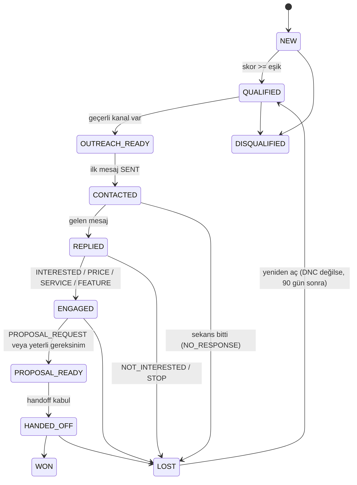

# Local Business Finder — Proje Planı ve Mimari Spesifikasyon

Sep 25, 2026 · @Ciwan

## A. Executive Summary

Local Business Finder; 2–3 kişilik bir ajans ekibinin web sitesi müşterisi bulmasını, bu işletmeleri analiz edip puanlamasını ve AI destekli, insan kontrollü bir satış sürecini tek bir Windows uygulamasından yürütmesini sağlayan bir **Tauri + React + Supabase** masaüstü CRM'idir.

Planın üç ana kararı:

1. **Keşif Google Places ile başlar.** Google Places, işletme keşfi için resmi ve güvenilir tek otomatik kaynaktır. Meta ve Google reklam veren keşfi resmi API'lerle tam otomatik yapılamaz; bu kaynaklar "assisted discovery + import" olarak tasarlanır.
2. **İlk mesaj (cold outreach) insan tarafından gönderilir.** Instagram, Facebook, LinkedIn ve TikTok resmi API'leri soğuk DM göndermeye izin vermez. WhatsApp yalnızca onaylı şablon mesajlarla ve ücretli olarak iş başlatabilir. Bu yüzden MVP'de AI mesajı hazırlar, insan tek tıkla gönderir (Level 1). Otomatik gönderim yalnızca e-posta için ve admin onayıyla açılır.
3. **AI, bilgi tabanına kilitli bir satış asistanıdır.** NVIDIA API arkasında bir `AIProvider` soyutlaması, yapılandırılmış JSON çıktılar, konuşma özetleri ve "bilmediği şeyi söylemez, fiyat uydurmaz" guardrail'leri ile çalışır. Teklif aşamasında insana devreder.

**Maliyet gerçekliği:** Supabase Free, NVIDIA deneme erişimi, mevcut Gmail/SMTP ve Google Places'ın ücretsiz kullanım kotası ile MVP büyük olasılıkla aylık 0 $ ek maliyetle çalışabilir. Ancak Google Cloud **kredi kartlı billing hesabı ister**, WhatsApp iş başlatan mesajlar **ücretlidir**, NVIDIA ücretsiz erişimi **üretim için garanti değildir**. Ayrıntılar Q bölümündedir.

**Kapsam kararı:** Proje 14 faza (0–13) bölünür. MVP (Faz 0–8) tek bir satış döngüsünü kanıtlar: Google Maps'ten bul → analiz et → puanla → AI taslak mesaj → manuel gönder → cevabı işle → teklife devret. Faz 9 gerçek kullanımla pilot/stabilizasyondur; Meta/Google Ads, otomatik gönderim, Jarvis ve updater sonrasında gelir.

## Karar Kaydı (Kodlamaya Başlamadan)

Açık soruların tamamı kapandı; ★ işaretliler sizin cevabınız, diğerleri planın önerisidir. Bu tablo SPEC'in bağlayıcı kısmıdır; bir karar değişirse önce burada güncellenir.

| # | Konu | Karar | Plana etkisi |
| --- | --- | --- | --- |
| D1 ★ | Hukuki danışmanlık | Danışılmayacak | Tasarımdaki korumalar zorunlu kalır: her mesajda gönderen kimliği + "bir daha yazmamamı isterseniz belirtin" satırı, global DNC, silme RPC'si, veri kaynağı kaydı. Risk kabul edildi (R bölümü). |
| D2 ★ | Coğrafya | İlk sürüm yalnızca Türkiye | `regionCode=TR`, `languageCode=tr`, TR telefon kuralları, TR resmi tatil takvimi, arayüz Türkçe. Çok ülke desteği için alanlar (country, tz) şimdiden şemada. |
| D3 ★ | Outreach hesapları | Ajansın ana hesapları (Instagram, Facebook, e-posta, WhatsApp) | Ana marka hesabı kısıtlanma riskine karşı düşük limitler: Instagram 15/gün, Facebook 15/gün, WhatsApp 10/gün ilk mesaj. Hesap ortak olduğu için "kim gönderdi" yalnızca uygulamadaki `mark_message_sent` kaydından izlenir. |
| D4 ★ | Google Cloud | Billing hesabı açılacak; 300 $ deneme kredisi bitince CSV'ye geçilecek | Uygulama içi sayaç hem krediyi hem SKU başına aylık ücretsiz kotayı izler; kredi bittiğinde keşif otomatik "yalnızca ücretsiz kota" moduna, kota da bittiğinde CSV/manuel moda düşer. Cloud'da 1 $ bütçe alarmı + günlük API kotası kurulur. VERIFY\_CURRENT\_DOCS: 300 $ kredinin süresi (genelde 90 gün) ve deneme bitince hesabın ücretli hesaba yükseltilmeden Maps kullanımına izin verip vermediği. |
| D5 ★ | AI sağlayıcı | Pilotta NVIDIA; kazanç başlayınca yeniden değerlendirilecek | `OpenAICompatibleProvider` + NVIDIA varsayılan. Ollama ve paralı sağlayıcı Faz 6'da yalnızca konfigürasyon olarak hazır; geçiş kod değişikliği gerektirmez. **Güncelleme 2026-09-27 (ADR 0007):** sıralı sağlayıcı zinciri — varsayılan OpenAI API → NVIDIA fallback. |
| D6 | Hedef kategoriler | Web sitesine dönüşümü yüksek işletmeler | Varsayılan liste: diş kliniği, estetik/güzellik merkezi, veteriner, kuaför/berber, fizyoterapi/psikolog/diyetisyen, spor salonu/pilates, restoran/kafe, oto servis/galeri, emlak ofisi, hukuk bürosu, eğitim kurumu/kurs, düğün/fotoğrafçı. "Randevu gerektirir" işareti: sağlık, güzellik, kuaför, veteriner, spor, oto servis. Liste Settings'ten düzenlenir. |
| D7 | KB içeriği ve fiyat | Paketler, fiyat aralıkları, teslim süreleri ve gerçek referanslar Faz 6 başlamadan girilir | AI fiyatı yalnızca müşteri sorduğunda (PRICE\_REQUEST) ve aralık olarak söyler; ilk mesajda fiyat yok. |
| D8 | Handoff sonrası | Teklif/sözleşme uygulama dışında; WON/LOST yeterli | Teklif modülü yok. |
| D9 | E-posta | Ajans domain'indeki ana adres; SPF/DKIM/DMARC kurulu olmalı | Faz 7 öncesi DNS kontrol listesi; günlük e-posta ilk mesaj limiti 30. |
| D10 | WhatsApp | MVP'de yalnızca wa.me asist; Cloud API Faz 11'de opsiyonel ve ücretli | — |
| D11 | Kanal önceliği | **E-posta → Instagram → Facebook → WhatsApp → LinkedIn → TikTok** | E-posta tek otomatikleşmeye uygun kanal olduğu için öne alındı; Settings'ten değiştirilebilir. |
| D12 | Level 2 sunucu gönderimi | Faz 11'de SMTP bilgisi Supabase Vault'ta tutulur | — |
| D13 | Yedekleme | Haftalık GitHub Actions `pg_dump` (şifreli artifact) + admin'in elle JSON dışa aktarımı | Faz 8'de dışa aktarım, Faz 13'te otomatik dump; pilot öncesi dump workflow'u erkene alınabilir. |
| D14 | Kurulum | Windows 10/11, `currentUser` kurulum, yönetici yetkisi gerekmez | — |
| D15 | Jarvis konumu | Henüz belli değil | Gateway Edge Function'da olduğu için Jarvis nerede çalışırsa çalışsın erişir. |
| D16 | Lead sahipliği | Herkes her lead'e yazabilir; ilk mesajı gönderen otomatik `assigned_to` olur, diğerleri gönderimden önce uyarı görür | — |
| D17 | Arayüz dili | Yalnızca Türkçe; metinler tek dosyada (i18n'e hazır) | — |

## B. Önerilen Nihai Mimari

İş mantığının büyük kısmı **TypeScript** ile paylaşılan bir `core` paketinde yaşar; Rust yalnızca işletim sistemi işlerini (güvenli kasa, HTTP, IMAP, updater) yapar; tüm paylaşılan API anahtarları Supabase Edge Functions arkasında kalır.

```
┌───────────────────────────────────── WINDOWS DESKTOP (Tauri 2) ──────────────────────────────────┐
│  React UI (pages/features)                                                    │
│     │                                                                          │
│  Application Services (TS)  ── packages/core: scoring, dedupe, stage machine, │
│     │                          DNC/outreach rules, channel router, analyzer      │
│     ├─ Data layer: supabase-js + TanStack Query (cache, retry, realtime)        │
│     ├─ Local worker: search queue runner, website analyzer, IMAP poller          │
│     └─ Tauri commands (Rust): keyring (Win Credential Manager), http fetch,      │
│                              SMTP/IMAP, open-url (ig.me / wa.me / mailto), log   │
└─────────────────────────────────────────────────────────────────────────┘
          │ HTTPS (anon key + user JWT)          │ direct HTTP (public websites)
          ▼                                      ▼
┌────────────────── SUPABASE (Free) ───────────────────┐   Business websites
│ Auth (email+password, invite-only)                    │   (analysis + contact)
│ PostgreSQL + RLS + RPC functions (stage transition,   │
│   log_activity, dedupe_merge, outreach_guard)         │
│ Realtime (postgres changes, workspace-filtered)       │
│ Vault (shared secrets, encrypted)                     │
│ Edge Functions (Deno/TS):                             │
│   places-search ──────────► Google Places API (New)   │
│   ai-gateway ─────────────► AIProvider → NVIDIA / …  │
│   admin-invite, admin-secrets                         │
│   [later] meta-webhook, email-sender (pg_cron),       │
│           jarvis-gateway                              │
└───────────────────────────────────────────────────────┘
          ▲
          │ (later) jarvis-gateway: schema-validated actions, scoped token
   ┌──────┴──────┐
   │   JARVIS    │  core Jarvis'i bilmez; Jarvis yalnızca sözleşmeli action'ları çağırır
   └─────────────┘
```

**Ana mimari kararlar:**

- **Tek dil, çok hedef.** Domain kuralları (`packages/core`) saf TypeScript'tir; hem React uygulamasında hem Deno Edge Functions'ta çalışır. Böylece Jarvis veya ileride sunucu tarafı otomasyon aynı kuralları yeniden yazmadan kullanır.
- **Veritabanı son hakemdir.** Yetki (RLS), stage geçişleri, DNC ve activity log DB fonksiyonları ve trigger'lar ile zorlanır; istemciye güvenilmez.
- **Paylaşılan secret'lar istemcide olmaz.** Google ve NVIDIA anahtarları Edge Function'larda; kişisel e-posta şifreleri Windows Credential Manager'da.
- **Ağır ama ücretsiz iş yerelde.** Web sitesi taraması ve IMAP okuma masaüstünde yapılır; Supabase egress ve fonksiyon kotasını tüketmez.
- **Uygulama kapalıyken:** MVP'de hiçbir mesaj gönderilmez; yalnızca DB'deki follow-up tarihleri "bekler". Sunucu tarafı otomatik gönderim (pg\_cron + Edge Function) Faz 11'de, yalnızca e-posta için eklenir. Karşılaştırma:

| Seçenek | Uygulama kapalıyken çalışır mı? | Maliyet | Karmaşıklık | Öneri |
| --- | --- | --- | --- | --- |
| Masaüstü worker (lease ile tek cihaz) | Hayır | 0 $ | Düşük | MVP |
| Supabase pg\_cron + Edge Functions | Evet | Free kotası içinde büyük olasılıkla 0 $ | Orta | Faz 11 (e-posta) |
| Harici worker (VPS, Fly, Railway) | Evet | Genelde ücretli | Orta-yüksek | Önerilmez |
| GitHub Actions cron | Evet (±5–15 dk sapma) | Private repo dakika kotası | Düşük | Yalnızca yedekleme için |

VERIFY\_CURRENT\_DOCS: Supabase Free planda pg\_cron ve Edge Function invocation kotaları; Free proje 1 hafta hareketsizlikte duraklatılıyor ([Supabase pricing](https://supabase.com/pricing)).

## C. Technology Stack

Tercih edilen stack (Tauri + React + TS + Rust + Supabase) korunur; eklenen her kütüphane ya ücretsiz açık kaynaktır ya da Supabase'in kendi parçasıdır.

| Katman | Teknoloji | Neden |
| --- | --- | --- |
| Masaüstü kabuk | Tauri 2 | Küçük kurulum (\~10–15 MB), WebView2, NSIS installer ve updater yerleşik |
| UI | React + TypeScript + Vite | Tercih edilen; Claude Code'un en verimli olduğu ekosistem |
| UI bileşenleri | Tailwind + shadcn/ui | Hızlı, erişilebilir tablo/dialog/form bileşenleri |
| Sunucu durumu | TanStack Query | Cache, retry, offline'da bekleme, realtime sonrası invalidation |
| UI durumu | Zustand | Hafif, global filtre/seçim durumu için yeterli |
| Form + doğrulama | react-hook-form + zod | Aynı zod şemaları action sözleşmelerinde de kullanılır |
| Domain mantığı | `packages/core` (saf TS) | Masaüstü + Edge Functions + Jarvis ortak kullanır; unit test kolay |
| Telefon | libphonenumber-js | TR numaralarını E.164'e çevirme, mobil/sabit ayrımı |
| HTML ayrıştırma | DOMParser (webview) / linkedom (test) | Website analyzer TS'de; testlerde Node'da çalışır |
| Rust eklentileri | tauri-plugin-http, keyring, lettre (SMTP), async-imap, tauri-plugin-log, -single-instance, -opener, -updater | CORS'suz fetch, Windows Credential Manager, e-posta, loglar, güncelleme |
| Backend | Supabase Auth + Postgres + RLS + Realtime + Vault + Edge Functions | Ortak veri, yetki DB seviyesinde, ek sunucu yok |
| DB testleri | Supabase CLI (lokal Docker) + pgTAP | RLS politikalarını otomatik test etmek için |
| Test | Vitest (+ MSW mock HTTP) | Hızlı, TS-native |
| AI | OpenAI-uyumlu `AIProvider` (NVIDIA ilk hedef) | NVIDIA API OpenAI-uyumlu; Ollama, OpenRouter vb. yalnızca `baseUrl` + model değişikliğiyle eklenir |
| Monorepo | pnpm workspaces | Tek repo: desktop, core, contracts, providers, supabase |
| CI / build | GitHub Actions + tauri-action (windows-latest) | Her fazda imzasız `.exe` üretir; son kullanıcı Node/Rust kurmaz |

**Bilinçli olarak kullanılmayanlar:** vektör veritabanı (bilgi tabanı küçük, doğrudan prompt'a sığar), yerel SQLite senkron motoru (tam offline-first gerekmiyor), Redux, ayrı bir Node backend sunucusu, browser otomasyonu (Playwright/Selenium ile DM).

VERIFY\_CURRENT\_DOCS: Tauri 2 plugin adları ve sürümleri; NVIDIA endpoint'inin OpenAI-uyumlu `chat/completions` ve JSON mode / structured output desteği.

## D. Application Modules

12 modülün 9'u MVP'de yer alır; "Proposal Ready" ve "Customers" ayrı sayfa yerine Leads üzerinde kayıtlı filtre olarak başlar, Campaigns MVP sonrasına kalır.

| Modül | İçerik | MVP |
| --- | --- | --- |
| Dashboard | Sayı kartları (yeni, bugün bulunan, iletişime geçilen, cevap veren, ilgilenen, teklif aşaması, müşteri, bekleyen follow-up, AI destekli açık konuşma), bugünün iş listesi | Evet |
| Discover | Şehir/ilçe/kategori/anahtar kelime ile arama, arama kuyruğu, API kullanım sayacı, CSV/URL import | Evet |
| Leads | Tablo + filtreler (skor, stage, website durumu, kanal, atanan kişi), lead detayı: website analizi, skor dökümü, kanallar, notlar, zaman çizelgesi | Evet |
| Conversations | Kanal bazlı konuşmalar, AI taslak, onayla/gönder, gelen cevabı yapıştır/içe al, intent etiketi, özet, gereksinimler | Evet |
| Follow-Ups | Bugün/gecikmiş follow-up listesi, hazır taslakla tek tık gönderim | Evet |
| Proposal Ready / Handoffs | Handoff özetleri, devralan kişi, durum | Evet (Leads filtresi + handoff kartı) |
| Customers | WON stage'indeki işletmeler | Evet — ayrı ekran + `customer_deals` (ADR 0007) |
| Campaigns | Hedef segment + kanal + sekans + limitler, kampanya performansı | Kısmen — otomatik gönderimsiz (ADR 0007); Level 2 Faz 11 |
| Activity Log | Kim, ne, ne zaman; actor tipi filtresi | Evet |
| Team | Üyeler, davet, rol | Evet (sade) |
| Knowledge Base | Şirket profili, hizmetler, paketler/fiyatlar, FAQ, referanslar, satış kuralları | Evet |
| Settings | Skor kuralları, kanal önceliği ve modları, limitler, follow-up sekansı, AI modeli, kişisel e-posta bağlantısı, secret yönetimi (admin), tanılama logları | Evet |

**ADR 0007 ile eklenenler (2026-09-27):** Reports (tarih aralıklı metrikler), Teklif Aşaması kanbanı, salt-okunur Jarvis AI asistan paneli, Discover haritası.

**Eklenmesi önerilen modül içi özellikler:** lead'i kişiye atama (`assigned_to`), "bugün benim işlerim" görünümü, lead birleştirme (merge) ekranı, tüm verinin JSON/CSV dışa aktarımı (Free planda otomatik yedek olmadığı için).

## E. Data Model

Önerilen 20 tablo MVP'de 22 tabloya dönüşür: 3 tablo kaldırılır, birleştirilir veya ertelenir, 5 eksik tablo eklenir, bazıları yeniden adlandırılır. Workspace verisi taşıyan her tabloda `workspace_id` bulunur; alt tablolar ebeveyne `(parent_id, workspace_id)` bileşik FK ile bağlanır, böylece bir kayıt başka workspace'in ebeveynine bağlanamaz.

**Listeye göre değişiklikler:**

- `lead_score_breakdowns` → kaldırılır; `businesses.lead_score` + `score_breakdown jsonb` + `scoring_version` yeterli (geçmiş skor gerekmiyor).
- `saved_searches` + `search_runs` → tek tablo `search_jobs` (kuyruk + geçmiş). Kayıtlı arama = `is_saved` bayrağı.
- `services`, `service_packages`, `sales_faq` → `services` + `service_packages` kalır; FAQ, referanslar, şirket profili ve satış kuralları tek `kb_entries` tablosunda `type` alanıyla tutulur.
- `settings` → `workspace_settings` (workspace başına tek satır, tipli jsonb alanlar).
- `ai_usage` → `ai_runs` (yalnızca metadata, prompt metni yok).
- `outreach_campaigns` → Faz 11'e ertelenir.
- **Eklenenler:** `business_sources` (discovery kaynakları), `workspace_invites`, `notes`, `worker_leases`, `stage_transitions` (geçiş kuralları kodda; bu tablo lead başına stage geçmişini tutar ve raporlama için kullanılır).

**Tablolar:**

| Tablo | Amaç | Temel alanlar | Kısıtlar |
| --- | --- | --- | --- |
| `profiles` | Kullanıcı profili | `id` (= auth.users.id), `full_name`, `created_at` | 1:1 auth.users |
| `workspaces` | Ajans/ekip | `id`, `name`, `created_by` | — |
| `workspace_members` | Üyelik + rol | `workspace_id`, `user_id`, `role` (ADMIN / MEMBER / AGENT), `created_at` | PK (workspace\_id, user\_id) |
| `workspace_invites` | Davet | `email`, `role`, `token_hash`, `expires_at`, `accepted_at`, `invited_by` | Yalnızca admin oluşturur |
| `workspace_settings` | Ayarlar | `automation_level`, `channel_priority`, `channel_modes`, `outreach_limits`, `followup_policy`, `scoring_rules`, `ai_config` (model adları; anahtar yok) | PK workspace\_id; yalnızca admin günceller |
| `businesses` | Global işletme profili (lead) | `name`, `normalized_name`, `category`, `address`, `city`, `district`, `lat`, `lng`, `google_place_id`, `website_url`, `website_domain`, `primary_phone_e164`, `rating`, `review_count`, `business_status`, `website_status`, `lead_score`, `score_breakdown`, `stage`, `lost_reason`, `do_not_contact`, `dnc_reason`, `dnc_at`, `assigned_to`, `last_contacted_at`, `next_action_at`, `version`, `created_by` | UNIQUE (workspace\_id, google\_place\_id); index (workspace\_id, website\_domain), (workspace\_id, primary\_phone\_e164), (workspace\_id, stage) |
| `business_sources` | Keşif kaynakları | `business_id`, `source` (GOOGLE\_PLACES / META\_ADS / GOOGLE\_ADS / MANUAL / IMPORT), `external_id`, `source_url`, `search_job_id`, `snapshot jsonb` (kısaltılmış), `first_seen_at`, `last_seen_at` | UNIQUE (workspace\_id, source, external\_id) |
| `contact_channels` | İletişim kanalları | `business_id`, `channel` (INSTAGRAM / FACEBOOK / LINKEDIN / TIKTOK / EMAIL / WHATSAPP / PHONE / WEBSITE\_FORM), `value`, `normalized_value`, `found_via` (PLACES / WEBSITE / JSON\_LD / MANUAL), `confidence`, `status` (UNVERIFIED / VALID / INVALID / BOUNCED), `is_primary` | UNIQUE (workspace\_id, channel, normalized\_value) |
| `website_analyses` | Analiz geçmişi | `business_id`, `requested_url`, `final_url`, `category`, `http_status`, `https`, `redirect_count`, `response_ms`, `checks jsonb`, `issues jsonb`, `analyzer_version`, `analyzed_at` | Son analiz `businesses.website_status`'a yansır |
| `notes` | Serbest notlar | `business_id`, `author_id`, `body`, `created_at` | Yazarı düzenler |
| `stage_transitions` | Stage geçmişi | `business_id`, `from_stage`, `to_stage`, `reason`, `actor_type`, `actor_user_id`, `created_at` | Yalnızca `transition_stage()` RPC yazar |
| `search_jobs` | Discovery kuyruğu + geçmiş | `provider`, `params jsonb`, `status` (QUEUED / RUNNING / DONE / FAILED / CANCELLED), `requested_by`, `api_calls`, `result_count`, `new_count`, `duplicate_count`, `next_page_token`, `error`, `is_saved`, `locked_by`, `locked_until` | — |
| `conversations` | Kanal başına konuşma | `business_id`, `channel`, `contact_channel_id`, `status` (OPEN / CLOSED), `handled_by` (AI\_ASSISTED / HUMAN), `summary`, `summary_upto_message_id`, `requirements jsonb`, `interest_level`, `last_inbound_at`, `last_outbound_at`, `email_thread_ref` | — |
| `messages` | Gelen/giden mesajlar | `conversation_id`, `direction` (IN / OUT), `status` (DRAFT / APPROVED / SENT / FAILED / RECEIVED / DISCARDED), `body`, `subject`, `author_type` (USER / AI / SYSTEM / JARVIS), `author_user_id`, `external_message_id`, `content_hash`, `intent`, `intent_confidence`, `ai_run_id`, `sent_at` | UNIQUE (workspace\_id, external\_message\_id); duplicate gönderim için content\_hash kontrolü |
| `follow_ups` | Planlı takip | `business_id`, `conversation_id`, `step`, `due_at`, `status` (PENDING / DRAFTED / SENT / CANCELLED / SKIPPED), `cancel_reason`, `message_id` | Bir conversation'da aynı step bir kez |
| `human_handoffs` | Teklif devri | `business_id`, `conversation_id`, `summary`, `requirements jsonb`, `assigned_to`, `status` (OPEN / ACCEPTED / CLOSED), `created_by_type` | Lead başına tek OPEN |
| `services`, `service_packages` | Satılabilir hizmetler | paket: `name`, `price_min`, `price_max`, `currency`, `features jsonb`, `delivery_days_min/max`, `is_active` | Yalnızca admin düzenler |
| `kb_entries` | Bilgi tabanı | `type` (COMPANY / FAQ / REFERENCE / SALES\_RULE / OBJECTION), `title`, `body`, `data jsonb`, `is_active`, `updated_by` | REFERENCE için `is_verified_real` zorunlu |
| `activity_logs` | Denetim izi | `id bigserial`, `actor_type` (USER / AI / JARVIS / SYSTEM), `actor_user_id`, `action`, `entity_type`, `entity_id`, `summary`, `metadata jsonb`, `created_at` | Yalnızca INSERT; UPDATE/DELETE trigger ile reddedilir |
| `ai_runs` | AI gözlemlenebilirliği | `provider`, `model`, `operation`, `prompt_version`, `status`, `error_code`, `input_tokens`, `output_tokens`, `latency_ms`, `entity_type`, `entity_id`, `requested_by`, `created_at` | Prompt/yanıt metni ve anahtar tutulmaz |
| `worker_leases` | Tek aktif worker | `workspace_id`, `job_type`, `holder_device_id`, `lease_until` | PK (workspace\_id, job\_type) |

**İlişki özeti:** `workspaces 1—N businesses 1—N {business_sources, contact_channels, website_analyses, notes, stage_transitions, conversations, follow_ups, human_handoffs}`; `conversations 1—N messages`; `messages N—1 ai_runs`.

**Konvansiyonlar:** UUID PK (activity\_logs hariç), `created_at/updated_at` trigger ile, enum'lar Postgres `enum` yerine `text + CHECK` (migration kolaylığı), iyimser eş zamanlılık için `businesses.version`, soft-delete yok (DNC ve LOST yeterli; gerçek silme yalnızca admin RPC ile, KVKK talebi için).

**Free plan boyut tahmini:** 20.000 işletme × \~3 KB (kaynak + kanallar + analiz dahil) ≈ 60 MB; 50.000 mesaj × \~1 KB ≈ 50 MB. 500 MB sınırı için `snapshot` ve `checks` alanları kısa tutulur, ham HTML asla saklanmaz.

## F. Authentication / Workspace Model

Kayıt kapalı, davetle giriş vardır: her kişi kendi e-posta/şifresiyle girer ve üyesi olduğu tek workspace'in tüm verisini görür.

**Akış:**

1. İlk kurulum: admin Supabase panelinden ilk kullanıcıyı oluşturur ve `bootstrap_workspace()` RPC'si çalışır (yalnızca hiç workspace yokken çalışır). Workspace oluşur, ilk kullanıcı ADMIN olur.
2. Davet: admin Team ekranından e-posta girer → `admin-invite` Edge Function (service role yalnızca burada) `auth.admin.inviteUserByEmail` çağırır ve `workspace_invites` kaydı açar.
3. Kabul: davetli şifresini belirler, ilk girişte `accept_invite()` RPC'si üyeliği oluşturur.
4. Oturum: supabase-js oturumu yenileme token'ıyla sürdürür; token Windows Credential Manager'da saklanır (localStorage değil).

**Roller:**

| Rol | Yetkiler |
| --- | --- |
| ADMIN | Üye davet/çıkarma, workspace ayarları, secret yönetimi, AI ve otomasyon seviyesi, KB düzenleme, gerçek silme (KVKK), tüm veriler |
| MEMBER | Discovery, CRM, notlar, konuşmalar, follow-up, handoff; KB'yi okur |
| AGENT (sonra) | Jarvis/servis hesapları için; yalnızca izin verilen action'lar |

**Kurallar:**

- Supabase Auth ayarı: public sign-up kapalı, e-posta doğrulama açık, minimum şifre uzunluğu 12.
- Uygulama tek workspace varsayar ama şema çoklu workspace'e hazırdır (ileride ikinci bir ajans eklemek migration gerektirmez).
- Son ADMIN kendini düşüremez veya silemez (DB trigger).
- Üye çıkarılınca verisi silinmez; yazdığı kayıtlar ve loglar korunur.

VERIFY\_CURRENT\_DOCS: Supabase Auth'un yerleşik SMTP'sinin saatlik e-posta limiti (davet/şifre sıfırlama için 3 kişilik ekipte yeterli olmalı; gerekirse kendi SMTP'niz bağlanır).

## G. Lead Discovery Architecture

Yalnızca Google Places tam otomatik ve resmi bir keşif kaynağıdır. Meta ve Google reklam verenleri resmi API ile Türkiye için listelenemez; bu kaynaklar "assisted discovery" olarak tasarlanır.

| Kaynak | Resmi yöntem | Türkiye'de otomatik keşif | Tasarım |
| --- | --- | --- | --- |
| Google Maps | Places API (New) – Text Search | Evet | `GooglePlacesProvider`, tam otomatik |
| Meta reklamları | Ad Library API | Hayır: ticari reklamlar yalnızca AB/UK'ye gösterilenler için döner; diğer ülkelerde yalnızca siyasi/sosyal konu reklamları | `MetaAdsProvider` = assisted + import |
| Google Ads | Resmi reklam veren arama API'si yok | Hayır | `GoogleAdsProvider` = assisted + import |

### G.1 GooglePlacesProvider

- **Çağrı:** masaüstü → `places-search` Edge Function → Places API (New) `searchText`. Sorgu: `"{kategori} {ilçe} {şehir}"`, `languageCode=tr`, `regionCode=TR`, sayfa başı 20 sonuç, `nextPageToken` ile en fazla 3 sayfa (\~60 sonuç/sorgu).
- **Field mask disiplini:** fatura, maskedeki en pahalı alanın SKU'suna göre kesilir. Önerilen tek maske: `places.id, displayName, formattedAddress, location, types, businessStatus, nationalPhoneNumber, internationalPhoneNumber, websiteUri, rating, userRatingCount, googleMapsUri`. Telefon/website/rating alanları Text Search'ü üst SKU'ya taşır; ama istek başına 20 işletme döndüğü için ayrı Place Details çağrısından çok daha ucuzdur.
- **Kota koruması:** `search_jobs.api_calls` toplanır; `workspace_settings.outreach_limits.places_monthly_cap` (örn. ücretsiz kotanın %80'i) aşılınca yeni iş kuyruğa alınmaz. Ek olarak Google Cloud Console'da API günlük kota limiti ve bütçe uyarısı kurulur (kodla aynı fikir, ikinci kilit).
- **Önbellek / tekrar:** aynı `(provider, params)` 30 gün içinde tekrar çalıştırılmak istenirse uyarı verilir. Mevcut `google_place_id` tekrar gelirse yalnızca `last_seen_at` güncellenir.
- **Kuyruk:** `search_jobs` tablosu. Çalıştırıcı = `worker_leases` kilidini tutan tek masaüstü; istekler arası 1 sn, 429 hatasında üstel geri çekilme. Uygulama kapanırsa lease süresi dolar, başka bir açık istemci devralır.
- **Saklama kısıtı:** Google Maps Platform koşulları içeriğin süresiz cache'lenmesini kısıtlar; `place_id` süresiz saklanabilir, diğer alanlar için periyodik yenileme gerekebilir. VERIFY\_CURRENT\_DOCS: Google Maps Platform Terms – caching/storage kuralları ve CRM'de saklama.

VERIFY\_CURRENT\_DOCS: Text Search alanlarının hangi SKU'ya (Essentials/Pro/Enterprise) düştüğü ve SKU başına aylık ücretsiz çağrı sayısı ([Places usage & billing](https://developers.google.com/maps/documentation/places/web-service/usage-and-billing)).

### G.2 MetaAdsProvider (assisted)

- **Gerçek:** Ad Library API ticari reklamları yalnızca AB/UK'de gösterilenler için döndürür; ayrıca kimlik doğrulaması ister ([Meta Ad Library tools](https://transparency.meta.com/researchtools/ad-library-tools), [API sınırları özeti](https://adlibrary.com/posts/meta-ad-library-api-limitations)). Türkiye'deki yerel işletmeleri bununla bulamazsınız.
- **Workflow:** kullanıcı Meta Ad Library web arayüzünü uygulama içinden (sistem tarayıcısında) önceden doldurulmuş aramayla açar → ilginç reklam verenin sayfa URL'sini veya Instagram kullanıcı adını "Meta reklam veren olarak ekle" alanına yapıştırır (toplu yapıştırma desteklenir) → sistem işletmeyi oluşturur, `business_sources.source = META_ADS` ve "reklam veriyor" skor sinyali ekler → Places'ta isim + şehir ile eşleştirme dener.
- **Scraping yok:** Ad Library sayfaları otomatik taranmaz.

### G.3 GoogleAdsProvider (assisted)

- **Gerçek:** Google Ads API yalnızca sizin reklam hesabınızı yönetir; başka reklam verenleri listelemez. Ads Transparency Center'ın resmi API'si yoktur. BigQuery'de bir Ads Transparency public dataset'i bulunur, ancak Türkiye ticari reklam verenlerini kapsayıp kapsamadığı doğrulanmalıdır. VERIFY\_CURRENT\_DOCS: `bigquery-public-data.google_ads_transparency_center` kapsamı (bölge, reklam veren alanları) ve BigQuery ücretsiz sorgu kotası.
- **Workflow:** kullanıcı Google'da hedef arama (örn. "kadıköy diş kliniği") yapar veya Transparency Center'ı açar → reklam verenin domain'ini yapıştırır → sistem domain üzerinden işletmeyi oluşturur/eşleştirir, `source = GOOGLE_ADS`.
- **Opsiyonel (Faz 10+):** BigQuery dataset'i Türkiye'yi kapsıyorsa, admin'in manuel çalıştırdığı bir sorgu çıktısı CSV olarak import edilir.

### G.4 Ortak: Import ve Duplicate Önleme

- **Import:** CSV (ad, telefon, website, instagram, şehir) ve tekli URL ekleme. Her import bir `search_jobs` kaydı oluşturur (`provider = IMPORT`).
- **Duplicate eşleştirme sırası (`packages/core/dedupe`):**
  1. `google_place_id` eşit → kesin eşleşme.
  2. `website_domain` eşit (www, alt yol ve linktr.ee/instagram gibi paylaşılan domainler hariç) → kesin.
  3. `primary_phone_e164` eşit → kesin (merkez/çağrı numaraları için 444/0850 hariç).
  4. Sosyal hesap `normalized_value` eşit → kesin.
  5. E-posta eşit (gmail.com gibi genel domain olsa da tam adres) → kesin.
  6. `normalized_name` benzerliği ≥ 0,9 ve aynı ilçe/adres ya da <150 m mesafe → **olası** eşleşme: otomatik birleştirilmez, "olası duplicate" kuyruğuna düşer.
- **Birleştirme:** `merge_businesses(keep_id, drop_id)` RPC'si kaynakları, kanalları, konuşmaları ve notları taşır; DNC bayrağı herhangi birinde varsa sonuçta da vardır; activity log'a yazılır.

## H. Website Analysis Engine

Analyzer masaüstünde çalışır, site başına en fazla 4 sayfa okur, tamamen pasiftir ve aynı taramada iletişim bilgilerini de çıkarır (I bölümü).

**Pipeline (`packages/core/website-analyzer`, fetch Rust'ta):**

1. **Normalize:** URL'yi temizle (şema ekle, UTM at). Places'tan gelen `websiteUri` Instagram/Facebook/linktr.ee ise site yok sayılır ve bu URL sosyal kanal olarak kaydedilir → `NO_WEBSITE`.
2. **DNS:** çözülmüyorsa → `BROKEN_WEBSITE` (sebep: DNS).
3. **Fetch:** GET, 10 sn timeout, en fazla 5 redirect, tanımlanabilir User-Agent, max 2 MB gövde. `http_status`, `final_url`, `redirect_count`, `response_ms`, HTTPS ve sertifika geçerliliği kaydedilir.
4. **Park/boş sayfa tespiti:** "domain for sale", hosting varsayılan sayfası, <200 karakter görünür metin → `BROKEN_WEBSITE` (sebep: PARKED/EMPTY).
5. **HTML kontrolleri** (ana sayfa + robots.txt izin veriyorsa en fazla 3 iç sayfa: `/iletisim`, `/contact`, `/hakkimizda`, `/randevu` benzeri linkler).
6. **Sınıflandırma** (aşağıdaki kurallar, versiyonlu).

**Kontrol listesi (`checks jsonb`):**

| Kontrol | Yöntem |
| --- | --- |
| HTTPS | final\_url şeması + sertifika hatası yok |
| Redirect problemi | >3 redirect, döngü veya HTTPS→HTTP düşüşü |
| Responsive | `<meta name="viewport">` var mı (yaklaşık sinyal) |
| Telefon / e-posta / WhatsApp linki | `tel:`, `mailto:`, `wa.me` / `api.whatsapp.com` href'leri |
| İletişim formu | `<form>` içinde email/tel/textarea alanları |
| Randevu sistemi | Bilinen widget domain'leri (Calendly, randevu SaaS'ları vb.) veya "randevu" CTA + form |
| Sosyal linkler | instagram/facebook/linkedin/tiktok/youtube href'leri |
| Meta title / description | varlık + uzunluk (title 10–70, description 50–160) |
| Yanıt süresi | ilk bayt ölçümü; >3 sn yavaş |
| Eskimişlik sinyalleri | Footer'daki telif yılı ≤ bugünün yılı − 3, Flash/frameset, jQuery < 1.9 |
| Mixed content | HTTPS sayfada `http://` kaynaklar |

**Sınıflandırma kuralları (v1):**

- `NO_WEBSITE`: URL yok veya yalnızca sosyal/link-in-bio.
- `BROKEN_WEBSITE`: DNS hatası, timeout, HTTP ≥ 400, SSL hatası nedeniyle açılamıyor, park/boş sayfa.
- `LOW_QUALITY_WEBSITE`: açılıyor ve "sorun puanı" ≥ 3. Ağırlıklar: HTTPS yok (2), viewport yok (2), iletişim yolu yok (tel/mail/wa/form hiçbiri) (2), randevu yok ve kategori randevu gerektiriyor (1), meta title/description yok (1), yanıt >3 sn (1), eskimişlik sinyali (1).
- `GOOD_WEBSITE`: diğer.

Her sorun `issues` dizisinde insan-okunur Türkçe metinle tutulur (örn. "Mobil uyum etiketi yok"); AI ilk mesajda bunları kullanır.

**Yapmadıkları:** port tarama, admin paneli yoklama, form gönderme, güvenlik açığı taraması, JS çalıştırma (headless tarayıcı yok; SPA sitelerde bu yüzden yanlış negatif olabilir, `issues`'a "JS ile render ediliyor, manuel kontrol önerilir" notu düşülür).

**Oran ve yeniden analiz:** domain başına saniyede 1 istek, eş zamanlı en fazla 4 domain. Analiz 30 günden eskiyse "yeniden analiz et" önerilir; `analyzer_version` değiştiğinde toplu yeniden analiz mümkündür.

**Opsiyonel (MVP sonrası):** Google PageSpeed Insights API ile mobil performans skoru (ücretsiz, anahtarlı kota). VERIFY\_CURRENT\_DOCS: PageSpeed Insights API günlük ücretsiz kota.

## I. Lead Scoring, Contact Discovery + Channel Routing

Skor, kanal bulma ve kanal seçimi saf fonksiyonlardır (`packages/core`); aynı girdi her zaman aynı sonucu verir ve %100 unit test edilir.

### I.1 Lead Scoring

Kurallar `workspace_settings.scoring_rules` içinde JSON'dur; admin UI'dan puanları değiştirir, `scoring_version` artar. Skor 0–100 arasına kırpılır ve `score_breakdown` ile birlikte saklanır.

| Kural | Varsayılan puan |
| --- | --- |
| NO\_WEBSITE | +40 |
| BROKEN\_WEBSITE | +35 |
| LOW\_QUALITY\_WEBSITE | +25 |
| GOOD\_WEBSITE | −20 |
| NO\_BOOKING (randevu kategorisinde) | +8 |
| NO\_CONTACT\_FORM | +5 |
| HIGH\_RATING (≥ 4,3) | +8 |
| HIGH\_REVIEW\_COUNT (≥ 50) | +10 |
| RUNS\_ADS (META\_ADS / GOOGLE\_ADS kaynağı) | +10 |
| HAS\_INSTAGRAM / HAS\_EMAIL / HAS\_WHATSAPP\_MOBILE | +4 / +4 / +3 |
| HAS\_PHONE | +2 |
| NOT\_OPERATIONAL (Places businessStatus ≠ OPERATIONAL) | skor = 0, stage = DISQUALIFIED |
| NO\_CONTACT\_CHANNEL | −30 |

Örnek çıktı: `{"score": 87, "version": 3, "reasons": [{"rule": "NO_WEBSITE", "points": 40}, {"rule": "HIGH_REVIEW_COUNT", "points": 10}]}`. Skor yeniden hesaplaması; analiz, kanal değişikliği veya kural versiyonu değiştiğinde tetiklenir.

### I.2 Contact Discovery

| Kaynak | Çıkarılan |
| --- | --- |
| Google Places | telefon, website (sosyal URL ise sosyal kanal) |
| `tel:` / `mailto:` / `wa.me` linkleri | telefon, e-posta, WhatsApp |
| JSON-LD (`LocalBusiness`, `Organization`) | `telephone`, `email`, `sameAs` sosyal linkler |
| Header/footer/iletişim sayfası hrefleri | Instagram, Facebook, LinkedIn, TikTok |
| Metin regex'i | e-posta (`[at]`, `(at)` gizlemeleri dahil), TR telefon kalıpları |
| Manuel | kullanıcı ekler |

**Normalizasyon ve doğrulama:**

- Telefon: libphonenumber ile E.164; TR mobil (+90 5xx) ise `WHATSAPP` adayı olarak da işaretlenir (`confidence` 0,5; wa.me linki sitede varsa 0,9).
- E-posta: sözdizimi + MX kaydı DNS sorgusu. SMTP ile "posta kutusu var mı" yoklaması **yapılmaz** (itibar riski).
- Sosyal: kullanıcı adına indirgenir (`instagram.com/abc_dental/?hl=tr` → `instagram:abc_dental`); paylaşım/post linkleri, `/p/`, `/reel/` ve platformun kendi hesapları elenir.
- Geliştirici/ajans imzaları (footer'daki "Designed by X" linkleri) işletme kanalı sayılmaz.

### I.3 Kanal Yetenekleri (Channel Capability)

| Kanal | Resmi otomatik ilk mesaj? | Mod | Asist mekanizması | Cevap yakalama |
| --- | --- | --- | --- | --- |
| Instagram | Hayır (API yalnızca size yazan kullanıcıya belirli pencere içinde cevap verir) | ASSISTED | Mesaj panoya kopyalanır, `ig.me/m/{kullanıcı}` açılır | Kullanıcı cevabı yapıştırır; Faz 10'da webhook |
| Facebook | Hayır (aynı kural, Messenger) | ASSISTED | `m.me/{sayfa}` | Yapıştırma; Faz 10'da webhook |
| LinkedIn | Hayır (genel mesaj API'si yok) | MANUAL | Profil açılır + kopyala | Yapıştırma |
| TikTok | Hayır | MANUAL | Profil açılır + kopyala | Yapıştırma |
| E-posta | Evet (kendi SMTP hesabınız) | DRAFT (varsayılan) / AUTOMATIC (admin açar) | Uygulama içinden SMTP ile gönderim | IMAP ile otomatik |
| WhatsApp | Yalnızca Cloud API + onaylı pazarlama şablonu + opt-in, ücretli | ASSISTED (MVP) | `wa.me/{numara}?text=` ile kişisel/Business uygulamada açılır | Yapıştırma |
| Telefon | — | MANUAL | Arama notu formu | Not |

VERIFY\_CURRENT\_DOCS: Instagram API with Instagram Login ve Messenger Platform mesajlaşma pencereleri (24 saat / human agent etiketi) ve işletmenin ilk mesajı başlatma yasağı. VERIFY\_CURRENT\_DOCS: WhatsApp Business Platform pazarlama şablonu için opt-in zorunluluğu ve Türkiye mesaj fiyatı ([WhatsApp pricing](https://developers.facebook.com/documentation/business-messaging/whatsapp/pricing)).

**Uyarı:** Kişisel WhatsApp hesabından çok sayıda tanımadığınız numaraya mesaj atmak hesabın kısıtlanmasına yol açabilir. Günlük WhatsApp limiti düşük (örn. 15) tutulur.

### I.4 Kanal Seçimi ve Fallback

`chooseChannel(business, channels, settings, history)` algoritması:

1. `do_not_contact = true` → hiçbir kanal (sert durdurma).
2. Aday kanallar: `status ∉ {INVALID, BOUNCED}` ve `confidence ≥ 0,5`.
3. Workspace önceliğine göre sırala (varsayılan (D11): E-posta → Instagram → Facebook → WhatsApp → LinkedIn → TikTok).
4. Her aday için guard'lar: kanal cooldown, günlük kanal limiti, aynı işletmeye son 30 günde başka kanaldan ilk mesaj gitmiş mi.
5. İlk geçen aday + modu (AUTOMATIC / DRAFT / MANUAL) döner; hiçbiri geçmezse sebep listesi döner.

**Fallback yalnızca teslim hatasında çalışır:** e-posta bounce, Instagram hesabı bulunamadı/mesaj kapalı, WhatsApp numarası yok. "Cevap gelmedi" fallback sebebi değildir; o follow-up'ın işidir. Opsiyonel ayar: tüm follow-up'lar bittikten 14 gün sonra ikinci kanaldan tek bir mesaj (varsayılan kapalı).

**Bir cevap herhangi bir kanaldan gelirse** tüm kanallardaki bekleyen follow-up'lar iptal edilir; "ilgilenmiyorum / yazmayın" türü cevap global DNC'ye döner.

### I.5 Outreach Safety (DB'de zorlanır)

`outreach_guard(business_id, channel)` RPC'si her gönderimden (asist dahil) önce çağrılır ve mesajı SENT'e taşıyan RPC bunu yeniden kontrol eder:

| Koruma | Varsayılan |
| --- | --- |
| DO\_NOT\_CONTACT | Global, tüm kanallar, geri alma yalnızca ADMIN + sebep |
| MAX\_FOLLOWUPS | 2 |
| DAILY\_OUTREACH\_LIMIT | Toplam 40 ilk mesaj/gün; e-posta 30, Instagram 15, Facebook 15, WhatsApp 10 (ana hesaplar, D3) |
| CHANNEL\_COOLDOWN | Aynı işletmeye aynı kanaldan 72 saat |
| DUPLICATE\_MESSAGE\_PROTECTION | Aynı conversation'da aynı `content_hash` 30 gün içinde reddedilir; aynı lead'e iki kullanıcının eş zamanlı gönderimi `businesses.version` + kilit ile engellenir |
| GÖNDERİM SAATLERİ | Hafta içi 09:00–18:30, Europe/Istanbul |

## J. AI Sales Agent

"Agent" serbest dolaşan bir araç kullanıcısı değil, kodun yönettiği 6 dar AI operasyonundan oluşan bir iş akışıdır: bağlamı kod toplar, model yalnızca şemalı JSON döner, çıktı kod tarafından doğrulanır. Bu, halüsinasyon ve maliyet riskini en aza indirir.

### J.1 Katmanlar

```
AIService (packages/core/ai)            ← operasyon başına: context builder + prompt + schema + validator
   │
   ▼  ai-gateway Edge Function          ← anahtar burada; rate limit; ai_runs kaydı; timeout/retry
   │
AIProvider interface
   ├─ OpenAICompatibleProvider(baseUrl, model)  → NVIDIA (ilk), OpenRouter, Groq, vLLM…
   ├─ OllamaProvider                           → yerel, ücretsiz (GPU'ya bağlı kalite)
   └─ MockAIProvider                           → testler, fixture yanıtlar
```

`AIProvider` sözleşmesi: `complete({model, system, messages, jsonSchema?, maxTokens, temperature}) → {text, json?, usage, latencyMs}`. Model adları koda gömülü değildir; `ai_config.routes` içinde operasyon → model eşleşmesi tutulur.

### J.2 Operasyonlar

| Operasyon | Girdi (kodun topladığı) | Çıktı şeması | Model sınıfı | Tetikleyici |
| --- | --- | --- | --- | --- |
| `draft_first_message` | İşletme adı/kategori/ilçe, website `issues` (en fazla 3), kanal, ilgili 1–2 paket özeti, satış kuralları | `{subject?, body, used_facts[]}` | Büyük | Kullanıcı "Taslak oluştur" |
| `classify_reply` | Son gelen mesaj + konuşma özeti | `{intent, confidence, requirements_delta, stop_request: bool, language}` | Küçük | Gelen mesaj kaydedilince |
| `draft_reply` | Özet + son 4 mesaj + intent + ilgili KB girdileri (paket/FAQ, anahtar kelime ile seçilir) | `{body, used_kb_ids[], proposes_handoff: bool, questions_for_human[]}` | Büyük | Intent STOP/NOT\_INTERESTED değilse |
| `update_summary` | Eski özet + yeni mesajlar | `{summary (≤ 120 kelime), requirements, interest_level}` | Küçük | Her 3 yeni mesajda bir veya handoff öncesi |
| `generate_handoff` | Özet + requirements + paketler | `{title, interest, features[], budget, timeline, price_discussed, open_questions[], recommended_package_id?}` | Büyük | PROPOSAL\_READY'ye geçişte |
| `followup_draft` | İlk mesaj + step no + işletme özeti | `{body}` | Küçük | Follow-up günü geldiğinde |

"İşletmeyi analiz et" ayrı bir AI çağrısı değildir: website analizi ve skor deterministik kodla yapılır; AI yalnızca bunları mesaja çevirir.

### J.3 Guardrails

**Prompt seviyesi:** "Yalnızca BAĞLAM bölümündeki bilgileri kullan. Bilmediğin bir şey sorulursa bunu ekip arkadaşımın netleştireceğini söyle ve `questions_for_human`'a yaz. Fiyat, indirim, tarih, referans uydurma. Karşı taraf istemiyorsa ısrar etme."

**Kod seviyesi (asıl güvence) – `validateDraft()`:**

1. JSON şemaya uymuyorsa 1 kez yeniden dene, sonra insan görevine düş.
2. **Fiyat kontrolü:** metindeki tüm para ifadeleri (`₺`, `TL`, `$`, rakam + "bin") aktif paketlerin `price_min/max` değerleriyle eşleşmeli; eşleşmeyen varsa taslak reddedilir.
3. **İndirim/yasak kelime listesi:** "indirim", "%", "bedava", "garanti" gibi ifadeler `sales_rules` izin vermiyorsa reddedilir.
4. **Referans kontrolü:** müşteri/marka adı geçiyorsa `kb_entries` REFERENCE (is\_verified\_real) listesinde olmalı.
5. **Teslim süresi:** gün/hafta ifadeleri paketlerin `delivery_days` aralığı dışındaysa reddedilir.
6. **Uzunluk ve ton:** kanal başına üst sınır (Instagram 600, e-posta 1.200 karakter).
7. **DNC:** `stop_request = true` veya intent STOP\_CONTACT ise hiçbir taslak üretilmez.

**Confidence eşikleri:**

| Durum | Davranış |
| --- | --- |
| STOP\_CONTACT, confidence ≥ 0,5 **veya** kural tabanlı kelime eşleşmesi ("yazmayın", "istemiyorum", "rahatsız etmeyin", "stop") | Hemen DNC + follow-up iptal; insan gözden geçirme işareti (asimetrik: durdurmak için düşük eşik) |
| Diğer intent, confidence ≥ 0,85 | Stage önerisi otomatik uygulanır (Level 2+), Level 1'de öneri olarak gösterilir |
| 0,6–0,85 | Yalnızca etiket + öneri; stage değişmez |
| < 0,6 | UNCLEAR; insan sınıflandırır |

### J.4 Maliyet Kontrolü

- **Özet tabanlı bellek:** modele tüm geçmiş değil, özet + son 4 mesaj gider.
- **Kısa, versiyonlu prompt'lar:** `packages/core/ai/prompts/*.ts`, `prompt_version` ai\_runs'a yazılır.
- **Model routing:** sınıflandırma/özet küçük modelde, mesaj yazma büyük modelde.
- **Cache:** aynı `(operation, input_hash, prompt_version)` 24 saat içinde tekrar istenirse önceki sonuç döner (yeniden üret butonu cache'i atlar).
- **Kota:** workspace başına günlük AI çağrı limiti (örn. 300), ai-gateway'de uygulanır.
- **Türkçe kalite:** Faz 6'da 30 örnekli bir değerlendirme seti (gerçekçi müşteri cevapları) ile aday modeller karşılaştırılır; model seçimi bu sonuca göre yapılır.

### J.5 NVIDIA Hakkında Önemli Not

build.nvidia.com ücretsiz erişimi model başına yayınlanmamış rate limitlerle çalışır ve koşulları, gerçek son kullanıcıya hizmet veren veya ticari işlem yapan kullanımı "production" sayarak ücretsiz katmanın kapsamı dışında tutar ([özet](https://decodethefuture.org/en/nvidia-nim-api-pricing-limits-guide/)). Gerçek işletmelere gönderilen satış mesajları bu tanıma girebilir. Bu yüzden:

- NVIDIA geliştirme ve pilot için kullanılır; mimari 1 satırlık konfigürasyonla başka OpenAI-uyumlu sağlayıcıya ya da Ollama'ya geçebilir.
- VERIFY\_CURRENT\_DOCS: NVIDIA API Trial Terms of Service – ticari/production kullanım tanımı, güncel rate limitler, Türkçe destekli model listesi.

### J.6 Otomasyon Seviyeleri

| Seviye | Ne otomatik | İnsan onayı | Teknik gereksinim | Risk |
| --- | --- | --- | --- | --- |
| Level 1 – Manual Assisted (MVP varsayılanı) | Keşif, analiz, skor, taslak, sınıflandırma, özet | Her gönderim | Yalnızca masaüstü | Düşük |
| Level 2 – AI Assisted | + E-posta ilk mesaj ve follow-up'ların otomatik gönderimi (limitler dahilinde), yüksek güvenli stage güncellemeleri | AI cevapları, fiyat içeren her mesaj, PROPOSAL\_READY | Uygulama açık veya Faz 11 sunucu worker'ı | Orta: e-posta itibarı, yanlış sınıflandırma |
| Level 3 – Full Automation | + AI cevaplarını da kendisi gönderir, PROPOSAL\_READY'ye kadar | Yalnızca handoff | Sunucu worker + resmi otomatik kanallar (pratikte yalnızca e-posta; WhatsApp ücretli şablon) | Yüksek: halüsinasyon, hesap kısıtlaması, yasal risk |

**Öneri:** Level 3 bu kanal gerçekliğinde az kazanç sağlar (sosyal kanallar zaten otomatikleştirilemez). Level 2 ile e-posta üzerinde sınırlı otomasyon yeterlidir; Level 3 flag olarak tasarlanır ama varsayılan kapalı kalır.

## K. CRM Pipeline

Önerilen 14 durumlu listede üç farklı kavram karışıyor: yaşam döngüsü aşaması, bir bayrak (DNC) ve bir görev (FOLLOW\_UP). Bunları ayırınca pipeline 11 aşamaya iner ve "DNC olan lead hangi stage'de?" gibi çelişkiler ortadan kalkar.

**Değişiklikler:**

- `FOLLOW_UP` → stage değil; `follow_ups` tablosundaki bekleyen görev. Lead CONTACTED'da kalır.
- `DO_NOT_CONTACT` → stage değil; `businesses.do_not_contact` global bayrağı. Hangi stage'de olursa olsun tüm gönderimleri keser.
- `INTERESTED` + `QUALIFYING` → tek `ENGAGED` stage'i; ilgi seviyesi `interest_level` (LOW/MEDIUM/HIGH) alanında.
- `NOT_INTERESTED` → `LOST` + `lost_reason = NOT_INTERESTED`. Diğer sebepler: `NO_RESPONSE`, `UNREACHABLE`, `HAS_PROVIDER`, `BUDGET`, `OTHER`.
- `HUMAN_HANDOFF` → `HANDED_OFF`, `CUSTOMER` → `WON`.
- Eklenen: `DISQUALIFIED` (kapalı işletme, iyi sitesi var, hedef dışı kategori).

**Nihai aşamalar:** `NEW → QUALIFIED → OUTREACH_READY → CONTACTED → REPLIED → ENGAGED → PROPOSAL_READY → HANDED_OFF → WON`, yan çıkışlar `DISQUALIFIED` ve `LOST`.



**Geçiş kuralları:**

| Geçiş | Kim yapabilir | Otomatik tetikleyici | Yan etki |
| --- | --- | --- | --- |
| NEW → QUALIFIED / DISQUALIFIED | USER, SYSTEM | Skor hesaplanınca (eşik 50, ayarlanabilir) | — |
| QUALIFIED → OUTREACH\_READY | USER, SYSTEM | `chooseChannel` bir kanal döndüğünde | — |
| OUTREACH\_READY → CONTACTED | SYSTEM | İlk mesaj SENT | Follow-up'lar planlanır |
| CONTACTED → REPLIED | SYSTEM | Gelen mesaj | Tüm follow-up'lar iptal |
| REPLIED → ENGAGED | USER, AI (conf ≥ 0,85, Level 2+) | Intent | — |
| → LOST (NOT\_INTERESTED) | USER, AI | Intent NOT\_INTERESTED | Follow-up iptal |
| herhangi → DNC bayrağı | USER, AI, SYSTEM | STOP\_CONTACT | Stage LOST, tüm kanallar kilitlenir |
| ENGAGED → PROPOSAL\_READY | USER, AI (onay ister) | PROPOSAL\_REQUEST veya ihtiyaç/zaman/ilgi dolu | `generate_handoff` çalışır |
| PROPOSAL\_READY → HANDED\_OFF | USER | Handoff kabul | AI taslak üretmeyi bırakır (`handled_by = HUMAN`) |
| HANDED\_OFF → WON / LOST | USER | — | — |
| DNC kaldırma | Yalnızca ADMIN, sebep zorunlu | — | Activity log |

**Uygulama:** tüm geçişler `transition_stage(business_id, to_stage, reason, expected_version)` RPC'si ile yapılır. Fonksiyon izin tablosunu (`packages/core/pipeline` ile aynı kuralların SQL karşılığı) kontrol eder, `stage_transitions` ve `activity_logs` yazar, `version` uyuşmazsa "başka biri güncelledi" hatası döner. `stage` kolonuna doğrudan UPDATE, RLS/column privilege ile kapalıdır.

## L. Conversation System

Her işletme-kanal çifti için tek conversation vardır; mesajlar DRAFT → APPROVED → SENT yaşam döngüsünden geçer ve "gönderildi" durumu her kanalda yalnızca guard'dan geçen RPC ile işaretlenir.

**Giden (outbound) akış:**

1. Kullanıcı veya follow-up görevi taslak ister → AI `DRAFT` mesaj oluşturur (`author_type = AI`).
2. Kullanıcı düzenler/onaylar → `APPROVED`.
3. Gönderim:
   - E-posta: Rust `lettre` ile kullanıcının SMTP hesabından gönderilir; `Message-ID` üretilir ve `external_message_id`'ye yazılır; başarılıysa `mark_message_sent()` RPC.
   - Asist kanallar: metin panoya kopyalanır, profil/sohbet linki açılır, kullanıcı "Gönderdim" der → `mark_message_sent()`. "Gönderemedim" seçenekleri (hesap yok, DM kapalı) kanalı INVALID yapar ve fallback'i tetikler.
4. `mark_message_sent()` içinde `outreach_guard` tekrar çalışır, stage CONTACTED'a geçer, follow-up'lar planlanır, activity log yazılır.

**Gelen (inbound) akış:**

| Kanal | Yakalama | Eşleştirme |
| --- | --- | --- |
| E-posta | Masaüstü IMAP poller (5 dk, yalnızca uygulama açıkken, gönderen kullanıcının kutusu) | `In-Reply-To` / `References` → external\_message\_id; yoksa gönderen adresi → contact\_channels |
| Bounce | IMAP'te `mailer-daemon` / DSN mesajları | Orijinal Message-ID → kanal BOUNCED, fallback |
| Instagram / Facebook / LinkedIn / TikTok / WhatsApp | Kullanıcı cevabı "Cevap yapıştır" alanına ekler (MVP); Faz 10'da IG/Messenger webhook | Kullanıcının seçtiği conversation |
| Telefon | Arama notu | Kullanıcı seçer |

Gelen mesaj kaydedilince: DB trigger follow-up'ları iptal eder → `classify_reply` çalışır → intent + requirements güncellenir → STOP ise DNC → değilse `draft_reply` taslak oluşturur ve "Cevap bekleyenler" listesine düşer.

**Otomatik yanıtlar:** "izindeyim", "mesajınız alındı" gibi auto-reply'lar `AUTO_REPLY` intent'i alır; follow-up'ı iptal etmez, yalnızca erteler. Intent listesine eklenenler: `AUTO_REPLY`, `WRONG_CONTACT` (yanlış kişi/işletme), `ALREADY_HAS_PROVIDER`.

**Özetler ve yapılandırılmış gereksinimler:** `conversations.summary` rolling özettir; `summary_upto_message_id` hangi mesaja kadar özetlendiğini tutar. `requirements` şeması:

```json
{
  "needsWebsite": true,
  "websiteType": "corporate | ecommerce | landing | redesign | null",
  "features": ["appointment", "whatsapp"],
  "budget": { "min": null, "max": null, "currency": "TRY", "stated": false },
  "timeline": "1 month",
  "decisionMaker": "owner | manager | unknown",
  "interestLevel": "HIGH",
  "priceDiscussed": false,
  "openQuestions": []
}
```

AI yalnızca `requirements_delta` önerir; kod mevcut nesneyle birleştirir, böylece bir halüsinasyon eski doğru bilgiyi silemez.

**Çoklu kullanıcı:** bir conversation'da taslak düzenlenirken diğer kullanıcılara "Ali düzenliyor" gösterilir (Realtime presence, opsiyonel). Gönderim anında `mark_message_sent` son mesajın değişmediğini kontrol eder.

## M. Follow-Up Automation

Follow-up'lar ilk mesaj gönderildiğinde DB'de tarihli satırlar olarak oluşturulur; MVP'de günü gelen follow-up otomatik gönderilmez, taslakla birlikte "Bugünün follow-up'ları" listesine düşer.

**Varsayılan politika (`workspace_settings.followup_policy`):**

```json
{
  "steps": [ { "afterDays": 3 }, { "afterDays": 4 } ],
  "maxFollowUps": 2,
  "sendWindow": { "days": [1,2,3,4,5], "from": "09:00", "to": "18:30", "tz": "Europe/Istanbul" },
  "skipHolidays": true,
  "afterSequence": "MARK_LOST_NO_RESPONSE",
  "secondChannelAfterDays": null
}
```

**Kurallar:**

- `due_at` hesaplanırken gönderim penceresine ve resmi tatillere (statik liste) kaydırılır.
- Bir step gönderilmeden sonraki step'in süresi işlemez (step 2, step 1'in `sent_at`'ından sayar).
- Kullanıcı bir follow-up'ı atlayabilir (SKIPPED) veya erteleyebilir.
- Sekans bittiğinde ve 7 gün daha cevap yoksa lead LOST (`NO_RESPONSE`) olur.

**Durma koşulları (DB trigger ile, tek yerde):** yeni gelen mesaj (AUTO\_REPLY hariç), stage ∈ {ENGAGED, PROPOSAL\_READY, HANDED\_OFF, WON, LOST, DISQUALIFIED}, `do_not_contact = true`, kanal INVALID/BOUNCED (fallback kanalında sekans yeniden başlamaz, yalnızca ilk mesaj gider). İptal edilen satır `cancel_reason` ile kalır.

**Uygulama kapalıyken:** hiçbir şey gönderilmez; açıldığında gecikmiş follow-up'lar "Gecikmiş" etiketiyle listelenir. Level 2'de (Faz 11) e-posta follow-up'ları pg\_cron → `email-sender` Edge Function ile gönderilebilir; bu, SMTP kimlik bilgisinin sunucuda (Vault) tutulmasını gerektirir ve ayrı bir karardır (X bölümü).

## N. Activity Log

Activity log yalnızca DB fonksiyonları ve trigger'lar tarafından yazılır, tüm üyeler okur, kimse (admin dahil) UI veya API üzerinden değiştiremez ya da silemez.

**Yazma yolları:**

- **Otomatik trigger'lar:** stage geçişi, DNC değişimi, not ekleme, mesaj SENT/RECEIVED, handoff, merge, üye ekleme/çıkarma, ayar değişikliği.
- **`log_activity(action, entity_type, entity_id, summary, metadata)` RPC:** özet olaylar için (örn. "Emin 10 yeni işletme listeledi" — search job bittiğinde tek satır, 10 ayrı satır değil).
- **Actor belirleme:** `actor_type` istemciden alınmaz. USER = `auth.uid()` bir insan üyeyse; AI = ai-gateway (service role) üzerinden `set_config('app.actor','AI')`; JARVIS = AGENT rolündeki Jarvis hesabı; SYSTEM = pg\_cron/trigger.

**Değişmezlik:**

- RLS: SELECT üyelere açık; INSERT/UPDATE/DELETE politikası yok.
- `REVOKE INSERT, UPDATE, DELETE ON activity_logs FROM authenticated, anon`.
- `BEFORE UPDATE OR DELETE` trigger'ı exception fırlatır (service role'ü de durdurur). Yalnızca proje sahibi DB seviyesinde trigger'ı kapatabilir; bu da Supabase'in kendi loglarında iz bırakır.
- Opsiyonel sertleştirme (MVP sonrası): her satıra önceki satırın hash'ini ekleyen zincir. 3 kişilik ekip için gerekli görünmüyor.

**Action sözlüğü (örnek):** `business.discovered_batch`, `business.merged`, `lead.stage_changed`, `lead.dnc_set`, `lead.dnc_removed`, `note.added`, `message.sent`, `message.received`, `ai.intent_classified`, `handoff.created`, `settings.updated`, `member.invited`, `jarvis.action_executed`.

**Activity Log ≠ Technical Logs:**

|  | Activity Log | Technical Logs |
| --- | --- | --- |
| Soru | Kim ne yaptı? | Neden bozuldu? |
| Yer | Supabase `activity_logs` | Yerel dosya (`%APPDATA%/LocalBusinessFinder/logs`, 7 gün rotasyon) + `ai_runs` + Edge Function logları |
| Gören | Tüm ekip | Geliştirici; Settings → Tanılama → "Log paketini dışa aktar" |
| İçerik | İş olayları | Hata yığınları, HTTP durumları, süreler; secret, token ve mesaj gövdesi maskelenir |

**Boyut:** satır başına \~300 bayt; günde 500 olayla yılda \~55 MB. 12 aydan eski kayıtlar için admin'e arşivleme (CSV dışa aktarım) sunulur; silme yine de trigger nedeniyle ayrı bir migration kararıdır.

## O. Jarvis Integration Architecture

Jarvis, core'a hiç dokunmadan, versiyonlu bir action sözleşmesi üzerinden bağlanır; core'un Jarvis'ten haberi yoktur ve uygulama Jarvis olmadan tamamen test edilebilir. Bu, klip uygulaması için planladığınız skill modeliyle aynı yaklaşımdır.

```
Jarvis Core ── Skill Registry ── Tool Router
                                   │  (manifest: jarvis/actions.json)
                                   ▼
                         jarvis-gateway (Edge Function)  ← Jarvis Adapter
                           • AGENT rolü token'ı doğrula
                           • action adı + zod şema doğrulama
                           • scope kontrolü (read / write / outreach)
                           • confirmation token (mutasyonlar için)
                           • idempotency key
                           • activity_logs(actor_type = JARVIS)
                                   │
                                   ▼
                     Action handlers (packages/core/actions)   ← UI ile aynı kod
                                   │
                                   ▼
                     Supabase RPC / tablolar (RLS)
```

**Neden Edge Function (yerel API değil):** Jarvis başka bir cihazda veya sunucuda çalışabilir ve masaüstü uygulaması kapalıyken de "bugün kaç lead bulundu?" cevaplanabilmelidir. Masaüstüne özgü işler (örn. website taraması başlatmak) kuyruğa iş bırakır; açık olan masaüstü worker'ı işler. İhtiyaç olursa aynı handler'ları sunan opsiyonel bir yerel `127.0.0.1` API sonradan eklenebilir.

**Action kataloğu (v1):**

| Action | Tür | Onay | Örnek komut |
| --- | --- | --- | --- |
| `analytics.summary` | read | — | "Bugün kaç yeni lead bulundu?" |
| `activity.list` (actor, since) | read | — | "Emin bugün kaç işletme buldu?", "Son 24 saatte ekip ne yaptı?" |
| `lead.list` (stage, filters) | read | — | "Teklif aşamasındaki müşterileri göster" |
| `lead.get` | read | — | — |
| `conversation.list` (repliedSince) | read | — | "Bugün cevap veren işletmeleri getir" |
| `conversation.summary` | read (AI) | — | "ABC Dental konuşmasını özetle" |
| `followup.list` (due) | read | — | "Bugünkü follow-up'ları göster" |
| `business.search` (city, district, category, onlyNoWebsite) | write (kuyruk) | Evet (API maliyeti) | "Kadıköy'de web sitesi olmayan işletmeleri tara" |
| `lead.update_status` | write | Evet | — |
| `note.add` | write | Hayır | — |
| `message.send` | outreach | Faz 12'de yok | Bilinçli olarak dışarıda |

**Sözleşme kuralları:**

- Tek kaynak: `packages/contracts/actions/*.ts` (zod) → build adımı `jarvis/actions.json` (JSON Schema + açıklama + scope + `requiresConfirmation`) üretir.
- Semver: `actions.json` içinde `version`; kırıcı değişiklik yeni action adı (`lead.list.v2`).
- Yapılandırılmış hata: `{code: "NOT_FOUND" | "FORBIDDEN" | "CONFIRMATION_REQUIRED" | "RATE_LIMITED" | "VALIDATION", message, details}`.
- Onay akışı: ilk çağrı `CONFIRMATION_REQUIRED` + `confirmationToken` + insan-okunur özet döner; Jarvis kullanıcıya sorar, token ile tekrar çağırır (5 dk geçerli).
- Jarvis asla tablolara doğrudan erişmez; AGENT rolünün RLS politikaları yalnızca okuma view'larına izin verir, yazma gateway'deki RPC'lerle olur.
- Opsiyonel: aynı manifestten bir MCP adapterü üretilebilir (Jarvis MCP konuşuyorsa).

**Şimdiden yapılacaklar (Faz 0–8 içinde, maliyeti düşük):** UI'nın tüm mutasyonları `packages/core/actions` handler'larından geçer; actor\_type alanı JARVIS değerini şimdiden kabul eder; `jarvis/` klasörü ve boş manifest oluşturulur.

## P. Security

Güvenlik modeli tek cümleyle: masaüstü uygulaması tamamen "güvenilmeyen istemci" sayılır; yetki RLS'te, paylaşılan secret'lar Edge Function/Vault'ta, kişisel secret'lar Windows Credential Manager'dadır.

### P.1 Supabase / RLS

- **Yardımcı fonksiyonlar** (`security definer`, `stable`, `search_path` sabit): `is_member(ws uuid)`, `is_admin(ws uuid)`, `my_workspace_ids()`.
- **Her tabloda:** `ENABLE ROW LEVEL SECURITY` + `FORCE`; SELECT/INSERT/UPDATE politikaları `is_member(workspace_id)`; admin-only tablolar (`workspace_settings`, `services`, `service_packages`, `kb_entries` yazma, `workspace_members` yazma) `is_admin(workspace_id)`.
- **workspace\_id'ye kör güven yok:** INSERT politikası `WITH CHECK (is_member(workspace_id))`; alt tablolarda bileşik FK `(parent_id, workspace_id)` sayesinde başka workspace'in ebeveynine bağlanamaz; RPC'ler `workspace_id`'yi parametre olarak değil, ebeveyn kayıttan türetir.
- **Kolon koruması:** `stage`, `do_not_contact`, `lead_score` doğrudan UPDATE ile değiştirilemez (column-level `REVOKE UPDATE` + RPC).
- **Testler:** pgTAP ile "A workspace'inin kullanıcısı B'nin lead'ini okuyamaz/yazamaz", "MEMBER ayar değiştiremez", "kimse activity log silemez" senaryoları CI'da koşar.
- **Supabase Security Advisor** her migration sonrası kontrol edilir (RLS kapalı tablo, `security definer` riskleri).

### P.2 Masaüstü

- İstemcide yalnızca Supabase URL + anon/publishable key bulunur (herkese açık olması tasarım gereğidir). Service role key hiçbir build'e girmez; CI'da bunun için bir grep kontrolü bulunur.
- Tauri capability dosyası: yalnızca gerekli komutlar; `http` eklentisi için izinli şemalar `https/http`, localhost ve özel IP aralıkları (10.x, 192.168.x, 169.254.x) engellenir (analyzer'ın SSRF benzeri kötüye kullanımını önler).
- CSP sıkı: harici script yok; web içeriği asla webview'da render edilmez (analyzer HTML'i yalnızca metin olarak parse eder).
- Oturum token'ı ve SMTP/IMAP şifresi `keyring` ile Windows Credential Manager'da.
- Tersine mühendislik riski: binary'den çıkarılabilecek tek şey anon key'dir; RLS nedeniyle tek başına veri açmaz.

### P.3 Secret Yönetimi

| Secret | Nerede | Kim kullanır | Nasıl ayarlanır |
| --- | --- | --- | --- |
| Supabase service role | Edge Function env | Yalnızca fonksiyonlar | Supabase paneli / CLI |
| Google Places API key | Supabase Vault | `places-search` | Admin UI → `admin-secrets` fonksiyonu (admin kontrolü) → Vault |
| NVIDIA / diğer AI key | Supabase Vault | `ai-gateway` | Aynı |
| Meta app secret / token (sonra) | Vault | `meta-webhook` | Aynı |
| Kişisel SMTP/IMAP (Gmail app password vb.) | Windows Credential Manager | O kullanıcının masaüstü | Settings → E-posta hesabı |
| Tauri updater imza anahtarı | GitHub Actions secret | CI | Bir kez |

- Vault'taki secret'ları okuyan fonksiyon `security definer` ve yalnızca service role'e `GRANT EXECUTE`; UI yalnızca "ayarlı / ayarlı değil" ve son 4 karakteri görür.
- Google key'i ayrıca Google Cloud'da yalnızca Places API (New) ile sınırlanır.
- Hiçbir log'a (activity, ai\_runs, teknik) key, token, şifre veya prompt metni yazılmaz; log fonksiyonunda maskeleme filtresi vardır.

VERIFY\_CURRENT\_DOCS: Supabase Vault'un Free planda kullanılabilirliği ve Edge Function'dan okunma yöntemi.

### P.4 Veri Koruma (Hukuki Not)

Bu hukuki tavsiye değildir. Şahıs işletmelerinin telefon/e-posta bilgileri KVKK kapsamında kişisel veri sayılabilir; Türkiye'de ticari elektronik ileti (6563 sayılı Kanun, İYS) kuralları e-posta/WhatsApp/SMS ile tanıtım mesajı için geçerlidir ve esnaf/tacir alıcılar için farklı koşullar olabilir. Tasarımdaki karşılıklar: her mesajda kim olduğunuz ve "bir daha yazmamamı isterseniz belirtin" satırı, global DNC, admin'e "işletmenin tüm verisini sil" RPC'si, veri kaynağı kaydı (`business_sources`). Kodlamaya başlamadan bir avukata veya İYS rehberine danışılması önerilir (X bölümü).

## Q. Cost Matrix

MVP (Level 1, 3 kişi, ayda \~2.000–5.000 yeni işletme) gerçekçi olarak **0 $/ay ek maliyetle** çalışabilir; ancak Google için kredi kartı zorunlu, NVIDIA'nın ücretsiz erişimi ticari kullanıma uygun olmayabilir ve WhatsApp otomasyonu her durumda ücretlidir.

| Servis | Amaç | Free tier | Tahmini kullanım | Ücret riski | Alternatif |
| --- | --- | --- | --- | --- | --- |
| Supabase | Auth, DB, Realtime, Edge Functions, Vault | Var: 500 MB DB, 50.000 MAU, 5 GB egress, 1 hafta hareketsizlikte duraklatma, otomatik yedek yok ([pricing](https://supabase.com/pricing)) | DB < 200 MB/yıl, 3 kullanıcı | Düşük. Risk: duraklatma ve yedek yokluğu. Pro 25 $/ay | Haftalık `pg_dump` (GitHub Actions veya manuel) |
| Google Places API (New) | Keşif | Mart 2025'ten itibaren SKU başına aylık ücretsiz çağrı kotası (eski 200 $ kredi yerine). Billing hesabı + kart **zorunlu** | 60 sonuç/sorgu = 3 çağrı; ayda 150 sorgu ≈ 450 çağrı | Orta: maske hatası veya döngü faturayı şişirebilir → Cloud kota limiti + bütçe alarmı + uygulama içi sayaç | CSV import |
| Meta Ad Library API | Reklam veren keşfi | Ücretsiz, kimlik doğrulamalı | Türkiye ticari reklamları için kullanılamaz | Yok | Assisted (web arayüzü + yapıştır) |
| Google Ads / Transparency | Reklam veren keşfi | Resmi API yok; BigQuery sandbox ücretsiz sorgu kotası | Opsiyonel | Düşük | Assisted |
| Instagram / Facebook Messaging API | Cevap yakalama (Faz 10) | Ücretsiz; app review gerekebilir | — | Yok; hesap kısıtlama riski | Yapıştırma |
| WhatsApp Business Platform | Otomatik WhatsApp | Mesaj başına ücret; pazarlama şablonları her zaman ücretli; müşteri hizmetleri penceresinde şablonsuz mesaj ücretsiz ([pricing](https://developers.facebook.com/documentation/business-messaging/whatsapp/pricing)) | MVP'de 0 | **Yüksek / kesin ücretli** + opt-in şartı | wa.me asist (0 $) |
| NVIDIA API | AI | Ücretsiz deneme, yayınlanmamış model başına rate limit; production kullanımı kapsam dışı ([özet](https://decodethefuture.org/en/nvidia-nim-api-pricing-limits-guide/)) | \~100–300 çağrı/gün | Koşul riski (ticari kullanım) | Ollama (yerel, 0 $) veya düşük maliyetli OpenAI-uyumlu sağlayıcı (ayda birkaç $) |
| E-posta (Gmail / Workspace / hosting SMTP) | Gönderim + IMAP | Mevcut hesap | 30–40 mail/gün/kişi | Düşük; kişisel Gmail'de günlük gönderim limiti ve spam işaretlenme riski | Kendi domain'inizde ayrı bir outreach adresi (SPF/DKIM/DMARC) |
| GitHub | Repo, CI, release | Private repo için aylık ücretsiz Actions dakikası (Windows runner 2× sayılır) | Build başına \~15 dk | Düşük | Yerel build |
| Kod imzalama sertifikası | SmartScreen uyarısını kaldırmak | Yok | — | Opsiyonel ücret | 3 kişilik iç kullanımda imzasız + "Yine de çalıştır" |
| Claude Code | Geliştirme | Mevcut abonelik | — | Var olan maliyet | — |

VERIFY\_CURRENT\_DOCS: Google Places SKU başına ücretsiz kota ve Text Search Enterprise fiyatı; Supabase Free limitleri; Gmail günlük gönderim limiti; GitHub Actions private repo dakika kotası; Azure Trusted Signing'in Türkiye'deki bireysel geliştiricilere açıklığı ve fiyatı.

## R. Risk Matrix

En yüksek üç risk teknik değil platform ve itibar kaynaklıdır: sosyal kanallarda otomasyon yasağı, e-posta/WhatsApp hesabının spam sayılması ve AI'ın yanlış bilgi vermesi.

| Risk | Olasılık | Etki | Mitigation |
| --- | --- | --- | --- |
| Platform API kısıtları (soğuk DM yok, Ads keşfi yok) | Kesin | Yüksek | AUTO/ASSISTED/MANUAL capability modeli; assisted discovery; beklentinin baştan doğru kurulması |
| Hesap kısıtlaması (Instagram, WhatsApp, Gmail) | Orta | Yüksek | Düşük günlük limitler, insan gönderimi, kişiselleştirilmiş mesaj, cooldown; ana marka hesabı yerine ayrı outreach hesabı düşünülebilir |
| Cold outreach hukuki riski (KVKK, 6563/İYS) | Orta | Yüksek | Opt-out satırı, global DNC, silme RPC'si, hukuki görüş (açık soru) |
| AI halüsinasyonu (fiyat, referans, süre) | Orta | Yüksek | KB-kilitli bağlam, `validateDraft` kuralları, Level 1'de her mesaj insan onayı, eval seti |
| Yanlış intent (özellikle STOP kaçırma) | Düşük-orta | Yüksek | Asimetrik eşik + kural tabanlı anahtar kelime yedek kontrolü |
| Duplicate outreach (iki kişi aynı lead'e yazar) | Orta | Orta | `outreach_guard`, version kilidi, lead atama, Realtime |
| Supabase Free kotası / duraklatma / yedek yok | Orta | Orta | Boyut disiplini, haftalık dump, JSON dışa aktarım, gerekirse Pro'ya geçiş (25 $) |
| Google Places beklenmeyen fatura | Düşük | Orta | Tek field mask, uygulama içi sayaç, Cloud günlük kota + bütçe alarmı |
| NVIDIA koşul/limit değişikliği | Orta | Orta | OpenAI-uyumlu provider soyutlaması; Ollama yedeği |
| Paylaşılan secret sızıntısı | Düşük | Yüksek | Secret'lar istemcide yok (Vault + fonksiyon), anahtar kısıtlamaları, rotasyon prosedürü |
| Masaüstü tersine mühendislik | Orta | Düşük | İstemcide yalnızca anon key; tüm yetki RLS'te |
| Web sitesi analizinde yanlış sınıflandırma (SPA, bot koruması) | Orta | Düşük | "Manuel kontrol" etiketi, kullanıcının kategori düzeltmesi skoru yeniden hesaplar |
| Türkçe AI kalitesi düşük | Orta | Orta | Model eval seti, operasyon başına model seçimi |
| Uygulama kapalıyken iş yapılmaması | Kesin (MVP) | Düşük | Bilinçli tercih; Faz 11'de e-posta için sunucu worker |
| Kapsam şişmesi | Yüksek | Yüksek | Faz kapıları, MVP tanımı, her faz için acceptance criteria |
| SmartScreen / antivirüs uyarısı | Yüksek | Düşük | Kurulum notu; ileride kod imzalama |

## S. MVP Scope

MVP, tek bir satış döngüsünü uçtan uca kanıtlar: "Kadıköy diş klinikleri" aramasından başlayıp, AI taslaklı ve insan gönderimli bir mesajın cevabının sınıflandırılmasına ve teklif devrine kadar.

**MVP'de var (Faz 0–8):**

- Windows `.exe` (NSIS, imzasız), Supabase Auth, davetle tek workspace, ADMIN/MEMBER
- Google Places keşfi + arama kuyruğu + kota sayacı, CSV/URL import
- Duplicate önleme (kesin eşleşmeler otomatik, olasılar kuyrukta) ve merge
- Website analizi (4 kategori) + contact discovery + lead skoru (dökümlü, ayarlanabilir)
- CRM: lead listesi/detay, 11 aşamalı pipeline, DNC, notlar, atama, Realtime senkron
- Knowledge Base (hizmetler, paketler, FAQ, referanslar, kurallar)
- AI: ilk mesaj taslakları, cevap sınıflandırma, cevap taslakları, özet, handoff özeti (NVIDIA + Mock + opsiyonel Ollama)
- Gönderim: e-posta SMTP (insan tıklar), diğer kanallar assisted
- Cevap yakalama: IMAP (e-posta), yapıştırma (diğerleri)
- Follow-up sekansı (taslaklı, insan gönderir) + outreach safety kuralları
- Human handoff, Activity Log, Dashboard, teknik loglar

**MVP'de yok:** Meta/Google Ads assisted discovery ekranları (CSV import zaten var), otomatik gönderim (Level 2), WhatsApp Cloud API, Instagram/Messenger webhook, Campaigns, Jarvis gateway, auto-updater, kod imzalama, çoklu workspace UI.

**Başarı kriteri:** 3 kullanıcı 2 hafta boyunca gerçek kullanımda; en az 200 işletme keşfedilmiş, 50 mesaj gönderilmiş, gelen cevapların ≥ %90'ı doğru sınıflandırılmış, hiç DNC ihlali ve duplicate gönderim yok, ek aylık maliyet 0 $.

## T. Development Phases

14 faz vardır; MVP Faz 8'in sonunda tamamlanır. Örnek sıradan farklar: installer için CI build Faz 0'a çekildi (ekip her fazda test edebilsin), activity log Faz 1'e alındı (sonraki her özellik log yazar), skor ve kanal yönlendirme ayrı faz oldu, gerçek kullanım pilotu (Faz 9) eklendi.

| Faz | Ad | Bağımlılık | Zorluk | MVP |
| --- | --- | --- | --- | --- |
| 0 | Foundation | — | Orta | ✓ |
| 1 | Auth + Workspace + RLS + Activity Log | 0 | Yüksek | ✓ |
| 2 | CRM Core + Import + Dedupe | 1 | Orta | ✓ |
| 3 | Google Places Discovery | 2 | Orta | ✓ |
| 4 | Website Analyzer + Contact Discovery | 2 | Orta | ✓ |
| 5 | Lead Scoring + Channel Routing + Outreach Safety | 3, 4 | Orta | ✓ |
| 6 | Knowledge Base + AI Integration | 1, 5 | Orta-yüksek | ✓ |
| 7 | Conversations + E-posta + Reply Intelligence + Handoff | 6 | Yüksek | ✓ |
| 8 | Follow-Ups + Dashboard + MVP sertleştirme | 7 | Orta | ✓ |
| 9 | Pilot + Stabilizasyon | 8 | Düşük-orta | — |
| 10 | Assisted Ads Discovery + Meta Webhooks | 9 | Orta | — |
| 11 | Level 2 Otomasyon + Campaigns | 9 | Yüksek | — |
| 12 | Jarvis Adapter | 8 | Orta | — |
| 13 | Production: Updater, İmzalama, Yedekleme | 8 | Orta | — |

### Faz 0 – Foundation

- **Amaç:** Claude Code'un güvenle çalışacağı iskelet ve her committe çalışan bir `.exe`.
- **Özellikler:** pnpm monorepo, Tauri 2 + React + Vite uygulama kabuğu (sidebar + boş sayfalar), `packages/core|contracts|providers` iskeleti, provider interface'leri + Mock'lar, ESLint/Prettier/tsc strict, Vitest, `CLAUDE.md`, `docs/` (spec, ADR şablonu), teknik log eklentisi.
- **DB:** Supabase projesi + CLI, boş migration zinciri, `supabase start` ile lokal DB.
- **Backend:** yok.
- **Desktop:** pencere, menü, tema, hata sınırı (error boundary), çevrimdışı banner iskeleti.
- **Testler:** örnek unit test; CI: lint + typecheck + test + `tauri build` (windows-latest, NSIS artifact).
- **Acceptance:** temiz Windows makinesinde CI'dan indirilen setup.exe kurulur, açılır, kaldırılır; `pnpm test` yeşil; repo'da secret yok.

### Faz 1 – Auth + Workspace + RLS + Activity Log

- **Amaç:** Çok kullanıcılı güvenli temel.
- **Özellikler:** giriş/çıkış, bootstrap, davet + kabul, Team ekranı, rol kontrolü, Activity Log ekranı, token'ın Credential Manager'da saklanması.
- **DB:** `profiles`, `workspaces`, `workspace_members`, `workspace_invites`, `workspace_settings`, `activity_logs`; `is_member/is_admin`; immutability trigger'ı; `log_activity`.
- **Backend:** `admin-invite` Edge Function.
- **Desktop:** auth akışı, route guard, Team, Activity Log sayfaları.
- **Testler:** pgTAP RLS paketi (çapraz workspace, rol, log silme/güncelleme reddi); auth akışı integration testi (lokal Supabase).
- **Acceptance:** iki farklı workspace'in kullanıcıları birbirinin verisini göremez; MEMBER ayar değiştiremez; activity log admin tarafından bile silinemez; davet edilen kullanıcı giriş yapıp ekibi görür.

### Faz 2 – CRM Core + Import + Dedupe

- **Amaç:** Lead'leri elle/CSV ile yönetebilen çalışır CRM.
- **Özellikler:** lead listesi (sanal tablo, filtre, sıralama), lead detayı, manuel ekleme, CSV import, dedupe motoru + olası duplicate kuyruğu + merge, notlar, atama, 11 aşamalı pipeline, DNC, Realtime senkron, iyimser kilit.
- **DB:** `businesses`, `business_sources`, `contact_channels`, `notes`, `stage_transitions`, `search_jobs` (import için); `transition_stage`, `merge_businesses`, `set_dnc` RPC'leri.
- **Backend:** yok (RPC).
- **Desktop:** Leads sayfası, detay paneli, import sihirbazı, merge ekranı.
- **Testler:** `normalizePhone`, `normalizeDomain`, `normalizeSocial`, dedupe eşleştirici, pipeline geçiş tablosu (unit); RPC'ler (integration).
- **Acceptance:** aynı işletmeyi farklı yazımla içeren CSV tek kayıt oluşturur; geçersiz stage geçişi reddedilir; bir kullanıcının değişikliği diğerinde ≤ 3 sn içinde görünür.

### Faz 3 – Google Places Discovery

- **Amaç:** Tam otomatik keşif.
- **Özellikler:** Discover formu (şehir/ilçe listesi, kategori, anahtar kelime), kuyruk, worker lease, sayfalama, kota sayacı ve limit, sonuç özeti (yeni/duplicate), tekrar arama uyarısı.
- **DB:** `worker_leases`; `search_jobs` alanlarının tamamı; kota görünümü.
- **Backend:** `places-search` Edge Function (Vault'tan key, field mask sabit, hata eşleme), `admin-secrets`.
- **Desktop:** Discover sayfası, kuyruk paneli, Settings → API anahtarları (admin).
- **Testler:** `MockPlacesProvider` ile kuyruk/sayfalama/429 geri çekilme; Places yanıtı → business eşleme unit testleri.
- **Acceptance:** "Kadıköy diş kliniği" araması ≤ 60 sonuçla tamamlanır; ikinci kez çalıştırmada yeni kayıt oluşmaz; iki açık istemci aynı işi iki kez çalıştırmaz; API key istemci bellek/dosyalarında bulunmaz. VERIFY\_CURRENT\_DOCS: Places API (New) Text Search sayfalama ve field mask adları.

### Faz 4 – Website Analyzer + Contact Discovery

- **Amaç:** Her lead için site durumu ve kanallar.
- **Özellikler:** H ve I.2 bölümlerindeki pipeline; toplu analiz kuyruğu; robots.txt; manuel kontrol etiketi; kanal düzenleme.
- **DB:** `website_analyses`; `businesses.website_status`.
- **Backend:** yok (masaüstü).
- **Desktop:** Rust `fetch_page` komutu (timeout, boyut, redirect, özel IP engeli), analiz sekmesi, sorun listesi.
- **Testler:** 25+ HTML fixture ile (park sayfası, SPA, JSON-LD, gizlenmiş e-posta, footer'da ajans linki) kontrol ve sınıflandırma testleri; MSW ile HTTP senaryoları (timeout, 404, redirect döngüsü).
- **Acceptance:** fixture setinde sınıflandırma %100; 100 gerçek sitelik manuel örneklemde kategori doğruluğu ≥ %90; analiz 100 site için < 5 dk.

### Faz 5 – Lead Scoring + Channel Routing + Outreach Safety

- **Amaç:** "Kime, hangi kanaldan, yazılabilir mi?" sorusunun deterministik cevabı.
- **Özellikler:** kural motoru + ayar ekranı, skor dökümü UI, `chooseChannel`, kanal capability matrisi, `outreach_guard`, limitler, cooldown, gönderim saatleri.
- **DB:** `workspace_settings` alanları; `outreach_guard` RPC.
- **Desktop:** Settings → Skor, Kanallar, Limitler; lead detayında "Önerilen kanal" kartı.
- **Testler:** skor ve routing için tablo tabanlı unit testler; DNC ve limit kuralları (unit + pgTAP).
- **Acceptance:** DNC'li lead için hiçbir yol gönderime izin vermez; kural değişikliği tüm skorları yeniden hesaplar; limit aşımında açık sebep mesajı görülür.

### Faz 6 – Knowledge Base + AI Integration

- **Amaç:** Güvenilir, KB'ye kilitli AI taslakları.
- **Özellikler:** KB ekranları; `AIProvider` (OpenAI-uyumlu + Mock + Ollama); `ai-gateway`; `draft_first_message`; `validateDraft`; ai\_runs ekranı (admin); model routing ayarı; Türkçe eval seti ve karar.
- **DB:** `services`, `service_packages`, `kb_entries`, `ai_runs`.
- **Backend:** `ai-gateway` (rate limit, cache, log).
- **Desktop:** Knowledge Base sayfası, lead detayında "Taslak oluştur".
- **Testler:** MockAIProvider ile context builder ve validator; uydurma fiyat/indirim/referans içeren sahte model çıktılarının reddedildiği testler; eval script'i (gerçek API, CI dışı, elle).
- **Acceptance:** 30 örnekte taslakların ≥ %90'ı düzenleme gerekmeden kullanılabilir bulunur; KB dışı fiyat içeren taslak hiç kullanıcıya gösterilmez; prompt metni hiçbir loga düşmez.

### Faz 7 – Conversations + E-posta + Reply Intelligence + Handoff

- **Amaç:** Mesaj gönder → cevap al → anla → cevapla → devret.
- **Özellikler:** Conversations sayfası; DRAFT/APPROVED/SENT akışı; SMTP gönderim; IMAP poller + bounce; assisted gönderim (pano + link + "Gönderdim"); cevap yapıştırma; `classify_reply`, `draft_reply`, `update_summary`, `generate_handoff`; requirements; handoff kartı ve devralma.
- **DB:** `conversations`, `messages`, `human_handoffs`; `mark_message_sent`, `record_inbound` RPC'leri; follow-up iptal trigger'ı (tablo Faz 8'de, trigger iskeleti burada).
- **Backend:** ai-gateway yeni operasyonlar.
- **Desktop:** Rust SMTP/IMAP komutları; Settings → E-posta hesabı.
- **Testler:** intent parsing ve STOP kural yedeği (unit); e-posta thread eşleme (fixture'lı .eml dosyaları); MockMessageProvider ile uçtan uca akış (integration).
- **Acceptance:** gönderilen e-postaya gelen cevap ≤ 5 dk içinde doğru conversation'a düşer; "bir daha yazmayın" içeren her cevap DNC'ye döner; handoff özeti örnekteki formatı üretir; iki kullanıcı aynı mesajı iki kez gönderemez.

### Faz 8 – Follow-Ups + Dashboard + MVP Sertleştirme

- **Amaç:** Günlük kullanıma hazır MVP.
- **Özellikler:** follow-up planlama/iptal/erteleme, "Bugünün işleri" listesi, Dashboard kartları, offline davranış (banner, retry, yeniden bağlanınca refetch), veri dışa aktarımı, installer'ın Türkçe metinleri ve ikonu.
- **DB:** `follow_ups`; iptal trigger'ları; dashboard için view/RPC (`analytics_summary`).
- **Desktop:** Follow-Ups ve Dashboard sayfaları.
- **Testler:** follow-up tarih hesabı (hafta sonu, tatil, pencere) ve durma koşulları (unit + pgTAP); ağ kesintisi simülasyonu (manuel test listesi).
- **Acceptance:** S bölümündeki MVP özellikleri çalışır; cevap gelen lead'in follow-up'ı kalmaz; Wi-Fi kapatılıp açıldığında uygulama çökmez ve veri tutarlıdır.

### Faz 9 – Pilot + Stabilizasyon

- **Amaç:** 2 hafta gerçek kullanım; S bölümündeki başarı kriterlerini ölçmek.
- **İçerik:** hata düzeltme, prompt ve skor ayarı, UX sürtünmeleri, Supabase kullanımının ölçülmesi, e-posta teslim oranı.
- **Acceptance:** başarı kriterleri karşılanır veya sapmalar belgelenip plan güncellenir.

### Faz 10 – Assisted Ads Discovery + Meta Webhooks

- **Özellikler:** "Meta reklam veren ekle" ve "Google reklam veren ekle" ekranları (önceden doldurulmuş arama linkleri + toplu yapıştırma), Places eşleştirme, RUNS\_ADS sinyali; Instagram/Messenger gelen mesaj webhook'u (`meta-webhook` Edge Function) ile cevapların otomatik yakalanması ve pencere içinde API ile cevap.
- **DB:** yeni alan gerekmez; webhook olay tablosu (`inbound_events`) eklenir.
- **Acceptance:** yapıştırılan 20 hesap duplicate oluşturmadan eklenir; bağlı Instagram hesabına gelen DM ≤ 1 dk'da conversation'a düşer. VERIFY\_CURRENT\_DOCS: Instagram API webhook, app review ve izin adları.

### Faz 11 – Level 2 Otomasyon + Campaigns

- **Özellikler:** automation level ayarı; e-posta için sunucu tarafı gönderici (pg\_cron → `email-sender`, SMTP bilgisi Vault'ta), günlük limitler sunucuda; `outreach_campaigns` (segment + sekans + limit); kampanya raporu; opsiyonel WhatsApp Cloud API provider (ücretli, opt-in şartıyla).
- **Acceptance:** uygulama kapalıyken planlanan e-posta follow-up'ı gönderim penceresinde gider; limit ve DNC sunucuda da zorlanır; otomasyon kapatıldığında ≤ 1 dk içinde tüm otomatik gönderim durur (kill switch).

### Faz 12 – Jarvis Adapter

- **Özellikler:** `jarvis-gateway`, AGENT rolü ve RLS, `actions.json` üretimi, onay token'ı, idempotency, O bölümündeki action kataloğu, `jarvis/SKILL.md`.
- **Acceptance:** 8 örnek komutun hepsi gateway üzerinden doğru veri döner; mutasyonlar onaysız çalışmaz; tüm Jarvis işlemleri activity log'da JARVIS olarak görünür.

### Faz 13 – Production: Updater, İmzalama, Yedekleme

- **Özellikler:** tauri-plugin-updater (imzalı güncelleme paketleri, `latest.json` GitHub Releases veya Supabase Storage'da), sürüm notları, otomatik haftalık DB yedeği, opsiyonel kod imzalama.
- **Acceptance:** v1.0.0 kurulu makine v1.0.1'i uygulama içinden günceller; yedekten başka bir Supabase projesine geri yükleme prova edilmiştir.

## U. Testing Strategy

Testlerin ağırlığı saf `packages/core` fonksiyonlarındadır ve CI'da hiçbir gerçek dış API çağrılmaz; gerçek API'ler yalnızca elle çalıştırılan "smoke" script'lerinde kullanılır.

| Katman | Araç | Kapsam | Nerede çalışır |
| --- | --- | --- | --- |
| Unit | Vitest | Lead scoring, telefon/domain/sosyal normalizasyonu, contact extraction, website sınıflandırma, dedupe, intent parsing + STOP yedeği, channel routing, DNC/limit/cooldown, follow-up tarih hesabı, pipeline geçişleri, `validateDraft` | Her commit, CI |
| DB / RLS | pgTAP + Supabase CLI (lokal Docker) | RLS izolasyonu, rol yetkileri, RPC'ler, trigger'lar, activity log değişmezliği | Her PR, CI |
| Integration | Vitest + lokal Supabase + Mock provider'lar | Auth akışı, CRM RPC'leri, discovery kuyruğu, AI adapter, mesaj yaşam döngüsü | Her PR, CI |
| Edge Functions | Deno test | places-search, ai-gateway (mock upstream) | Her PR |
| Rust | `cargo test` | fetch sınırları, özel IP engeli, keyring sarmalayıcı | Her PR (windows runner) |
| Kontrat | zod → JSON Schema snapshot | Action sözleşmelerinin istemeden değişmesi | Her PR |
| AI eval | Script (gerçek model) | 30 örnekli Türkçe set: intent doğruluğu, taslak kalitesi, guardrail ihlali | Elle, prompt/model değişince |
| Manuel E2E | Kontrol listesi (`docs/qa/phase-XX.md`) | Kurulum, gönderim, offline, iki kullanıcı senaryoları | Faz sonu |

**Mock provider'lar (`packages/providers/mocks`):** `MockPlacesProvider` (fixture JSON, sayfalama, 429 simülasyonu), `MockAIProvider` (operasyon + girdi hash'ine göre fixture; bilerek hatalı çıktı modu), `MockMessageProvider` (gönder/bounce/cevap simülasyonu), `MockWebsiteFetcher` (HTML fixture'ları), `MockClock` (follow-up testleri).

**Kurallar:** yeni bir kural/fonksiyon testsiz merge edilmez; her bug düzeltmesi önce kırmızı bir test ekler; `packages/core` için satır kapsamı hedefi %85; UI için yalnızca kritik bileşen testleri (tam E2E otomasyonu MVP'de gereksiz).

## V. Windows Build / Installer

Kurulum dosyası GitHub Actions'ta Tauri'nin NSIS bundler'ı ile üretilir; son kullanıcı yalnızca `LocalBusinessFinder_x.y.z_x64-setup.exe` indirir ve Node/Rust/terminal gerekmez.

**`tauri.conf.json` önerilen ayarlar:**

- `bundle.targets: ["nsis"]`, `productName: "Local Business Finder"`, `identifier: "com.<ajans>.localbusinessfinder"`.
- `bundle.windows.nsis.installMode: "currentUser"` (yönetici yetkisi istemez; ekip bilgisayarlarında sürtünmesiz).
- `bundle.windows.nsis.languages: ["Turkish", "English"]`, `displayLanguageSelector: false`.
- `bundle.windows.webviewInstallMode: "downloadBootstrapper"` (Windows 10/11'de WebView2 genelde yüklüdür; offline kurulum gerekiyorsa `embedBootstrapper`).
- İkon, installer header/sidebar görselleri, lisans metni (opsiyonel).

**Sihirbaz adımları:** Welcome → Install Directory → Desktop Shortcut seçeneği → Install → Finish ("Uygulamayı başlat" kutusu). Tauri'nin varsayılan NSIS şablonu bu adımların çoğunu içerir; masaüstü kısayolu seçeneği için gerekirse `nsis.template` veya `installerHooks` ile özelleştirilir. VERIFY\_CURRENT\_DOCS: Tauri 2 NSIS şablonunun varsayılan sayfaları, masaüstü kısayolu davranışı ve `installerHooks` desteği.

**CI pipeline (`.github/workflows/release.yml`):**

1. Tetik: `v*` tag'i (release) ve her PR (artifact).
2. `windows-latest`: pnpm install → test → `tauri-action` build.
3. Env: yalnızca `VITE_SUPABASE_URL` ve `VITE_SUPABASE_ANON_KEY` (public), updater için `TAURI_SIGNING_PRIVATE_KEY` (Faz 13).
4. Çıktı: setup.exe → GitHub Release (taslak). Faz 13'te `latest.json` + imzalı güncelleme paketi.

**Sürümleme:** SemVer; faz sonları `v0.<faz>.0` (örn. Faz 3 sonu `v0.3.0`), MVP `v0.8.0`, pilot sonrası `v1.0.0`.

**Kod imzalama:** İmzasız installer SmartScreen'de "Windows bilgisayarınızı korudu" uyarısı verir; 3 kişilik iç kullanımda "Ek bilgi → Yine de çalıştır" kabul edilebilir. Dağıtım büyürse OV sertifika veya Azure Trusted Signing değerlendirilir (ücretli).

**Updater (Faz 13):** `tauri-plugin-updater` imza doğrulamalı çalışır (ücretsiz, kendi anahtar çifti). `latest.json` public bir yerde olmalı: private repo release'leri token gerektirdiği için ya ayrı public "releases" reposu ya da Supabase Storage public bucket kullanılır.

## W. Claude Code Execution Strategy

Tüm projeyi tek prompt'la vermek yanlış olur: bağlam taşar, RLS gibi kritik kısımlar yüzeysel kalır ve hatalı bir erken karar her şeye yayılır. Bunun yerine repo içinde kalıcı bir spec + faz başına küçük, test kapılı oturumlar kullanın.

### W.1 Workflow

```
docs/SPEC.md (bu planın nihai hali, tek doğruluk kaynağı)
      ↓
docs/phases/PHASE-XX.md (faz spec'i: kapsam, dosyalar, acceptance, kapsam dışı)
      ↓
Claude Code: Plan Mode → planı okursunuz/düzeltirsiniz → onay
      ↓
Alt adımlar (her biri ≤ ~1 oturum): implement → test → checkpoint commit
      ↓
Faz sonu: tüm testler + manuel QA listesi + setup.exe ile deneme
      ↓
Merge → tag v0.XX.0 → SPEC.md'yi öğrenilenlerle güncelle → /clear → sonraki faz
```

### W.2 Kurallar (`CLAUDE.md` içeriği)

- Proje özeti, mimari kararlar ve klasör haritası (kısa; ayrıntı `docs/SPEC.md`'de).
- Komutlar: `pnpm dev`, `pnpm test`, `pnpm test:db`, `supabase start`, `pnpm tauri build`.
- Yasaklar: service role key'i veya herhangi bir secret'ı istemci koduna, `.env`'e commit'e, loglara koymak; eski migration dosyalarını düzenlemek (her zaman yeni migration); testlerde gerçek API çağırmak; RLS'i kapatmak; faz kapsamı dışındaki dosyaları refactor etmek.
- Zorunluluklar: her domain kuralı `packages/core`'da ve test'li; her yeni tabloya RLS + pgTAP testi; her mutasyon activity log yazar; büyük değişiklikten önce checkpoint commit; iş bitince test çıktısını göster.
- VERIFY\_CURRENT\_DOCS etiketli bir konuya gelindiğinde: kodlamadan önce resmi dokümanı kontrol et, bulguyu `docs/adr/` altına yaz.

### W.3 Faz Prompt Şablonu

```
docs/SPEC.md ve docs/phases/PHASE-03.md dosyalarını oku.
Yalnızca PHASE-03 kapsamını uygula; kapsam dışı maddelere dokunma.
Önce Plan Mode'da: dosya listesi, migration'lar, test listesi, riskler.
Onay sonrası alt adım alt adım ilerle; her alt adım sonunda testleri çalıştır ve
"checkpoint: <adım>" commit'i at. Acceptance criteria'nın her maddesi için
nasıl doğruladığını raporla. VERIFY_CURRENT_DOCS maddelerini ADR olarak kaydet.
```

**Pratik ipuçları:** Faz 1 (RLS) ve Faz 7 (mesaj akışı) migration'larını satır satır kendiniz okuyun; Claude Code'dan ayrı bir oturumda "bu RLS politikalarını saldırgan gözüyle gözden geçir" isteyin; bir oturum 2 kez aynı hatada dönüyorsa durdurup alt adımı küçültün.

### W.4 Git Stratejisi

- `main` her zaman build alınabilir ve testleri yeşil; doğrudan commit yok.
- Faz başına bir dal: `feature/p00-foundation`, `feature/p01-auth-rls`, `feature/p03-google-places`, `feature/p06-ai-agent` …; büyük fazlarda alt dallar (`feature/p07a-email`, `feature/p07b-intent`).
- Conventional Commits (`feat:`, `fix:`, `test:`, `chore:`, `db:`); ara noktalar `checkpoint: ...`.
- PR (tek kişi olsanız da): CI yeşil olmadan merge yok; squash merge; faz sonunda tag.
- `.gitignore`: `.env*`, `supabase/.temp`, `target/`, `node_modules/`, log dosyaları; pre-commit'te `gitleaks` (ücretsiz) ile secret taraması.
- GitHub branch protection (private repo'da ücretsiz planda kısıtlı olabilir) yoksa disiplin: `main`'e yalnızca PR.

### W.5 Proje Yapısı

```
local-business-finder/
├─ CLAUDE.md
├─ docs/
│  ├─ SPEC.md                  # bu plan
│  ├─ phases/PHASE-00.md …     # faz spec'leri
│  ├─ adr/                     # mimari kararlar + VERIFY bulguları
│  └─ qa/                      # faz sonu manuel test listeleri
├─ apps/
│  └─ desktop/
│     ├─ src/
│     │  ├─ app/               # router, providers, layout
│     │  ├─ features/          # discover, leads, conversations, followups, dashboard,
│     │  │                     # knowledge-base, activity, team, settings (her biri: components/hooks/api)
│     │  ├─ components/ui/     # shadcn
│     │  ├─ lib/               # supabase client, query client, tauri bridge
│     │  └─ workers/           # search queue runner, analyzer runner, imap poller
│     └─ src-tauri/
│        ├─ src/commands/      # fetch_page, smtp_send, imap_poll, secrets, open_url
│        ├─ src/security/      # keyring, url/IP filtreleri
│        ├─ capabilities/
│        └─ tauri.conf.json
├─ packages/
│  ├─ core/                    # saf TS: scoring, dedupe, normalize, pipeline, routing,
│  │                           # outreach-rules, website-analyzer, followup, ai (prompts, validators), actions
│  ├─ contracts/               # zod şemaları, DB tipleri (supabase gen types), action sözleşmeleri
│  └─ providers/               # AIProvider, PlacesProvider, MessageProvider… + mocks/
├─ supabase/
│  ├─ migrations/              # politikalar migration içinde (ayrı policies/ klasörü yok)
│  ├─ functions/               # places-search, ai-gateway, admin-invite, admin-secrets, (sonra) jarvis-gateway…
│  ├─ tests/                   # pgTAP
│  └─ seed.sql                 # demo workspace + fixture lead'ler
├─ jarvis/
│  ├─ SKILL.md
│  └─ actions.json             # contracts'tan üretilir, elle düzenlenmez
└─ .github/workflows/          # ci.yml, release.yml
```

Örnekteki yapıdan farklar: `shared/` yerine `packages/contracts` + `packages/core` (Edge Functions de import edebilsin diye); `supabase/policies/` kaldırıldı (politika tabloyla aynı migration'da olmalı); Rust'ta `adapters/services` katmanı yok (iş mantığı TS'de).

## X. Open Questions

&#32;

&#32;ilk başda türkiye

&#32;web site dönüşümü fazla olacak işletmeler

Tüm açık sorular kapatıldı; kararlar dokümanın başındaki **Karar Kaydı** tablosunda (D1–D17). Kodlama sırasında yeni bir soru çıkarsa `docs/adr/` altında ADR olarak kaydedilir ve Karar Kaydı'na eklenir.

**Faz 6'dan önce sizin hazırlamanız gerekenler:** hizmet listesi, paketler (ad, özellikler, fiyat aralığı, teslim süresi), 10–15 SSS, izinli gerçek referanslar, ajans tanıtım metni, satış kuralları (indirim yok vb.) ve 30 gerçekçi müşteri cevabı örneği (AI eval seti).

**Faz 7'den önce:** ajans domain'inde SPF/DKIM/DMARC kontrolü, e-posta hesabı için uygulama şifresi (app password).

## Y. Final Recommendation

Mimari hedeflerinizin hepsini koruyabilir, ama projenin değeri "tam otomasyonda" değil, **iyi keşif + iyi analiz + hızlı insan onayı** döngüsünde. Platform kuralları sosyal kanallarda zaten insanı döngüde tutuyor; bunu kısıt değil, tasarımın merkezi yapın.

**Sadeleştirme önerileri:**

1. **İş mantığını TypeScript'te toplayın**, Rust'ı ince tutun. Tek dil, Edge Functions ve Jarvis ile paylaşım, daha hızlı Claude Code geliştirmesi.
2. **Pipeline'ı 11 aşamaya indirin**; FOLLOW\_UP ve DNC stage değil.
3. **"AI agent"ı tool-calling ajan olarak değil, 6 dar operasyon olarak kurun.** Daha ucuz, daha test edilebilir, halüsinasyona karşı kod seviyesinde korunur.
4. **AI provider'ı "OpenAI-uyumlu" olarak soyutlayın**; NVIDIA, Ollama ve diğerleri aynı sınıfın konfigürasyonu olur.
5. **Meta/Google Ads'i "kaynak" değil "sinyal" olarak düşünün:** asıl keşif Google Places; reklam verdiği bilinen işletme skorunu yükseltir.
6. **Vektör DB, ayrı backend, headless tarayıcı ve offline-first senkron eklemeyin**; bu ölçekte gereksiz.

**İyileştirme önerileri:**

1. **E-postayı birincil otomasyon kanalı yapın** ve kendi domain'inizde, doğru kurulmuş (SPF/DKIM/DMARC) bir outreach adresi kullanın; tek resmi, ücretsiz ve otomatikleştirilebilir kanal bu.
2. **Güvenlik sınırlarını DB'ye koyun** (RLS, `transition_stage`, `outreach_guard`, log trigger'ları). İstemci ve AI hataları kuralları delemez.
3. **Mesajların değerini website analizinden alın:** "Sitenizde mobil uyum etiketi yok, randevu formu yok" gibi somut, doğrulanabilir gözlemler yanıt oranını AI'ın üslûbundan daha çok artırır.
4. **Pilot fazını atlamayın.** Faz 10–13'ün önceliğini pilottaki gerçek verilerle belirleyin.
5. **Kararlar kapandı** (Karar Kaydı, D1–D17): bu dokümanı `docs/SPEC.md` olarak repo'ya koyup Faz 0 spec'i (`docs/phases/PHASE-00.md`) ile başlayın.

## Kaynaklar

- [Google Places API (New) – Usage and Billing](https://developers.google.com/maps/documentation/places/web-service/usage-and-billing)
- [Google Places API free tier limits 2026 (MapsLeads)](https://www.mapsleads.co/blog/google-places-api-free-tier-limits-2026)
- [Supabase Pricing](https://supabase.com/pricing)
- [WhatsApp Business Platform Pricing (Meta)](https://developers.facebook.com/documentation/business-messaging/whatsapp/pricing)
- [Meta Ad Library tools](https://transparency.meta.com/researchtools/ad-library-tools)
- [Meta Ad Library API limitations (adlibrary.com)](https://adlibrary.com/posts/meta-ad-library-api-limitations)
- [Google Ads Transparency Center API (adlibrary.com)](https://adlibrary.com/posts/google-ads-transparency-center-api)
- [Google Ads Transparency BigQuery dataset forum thread](https://discuss.google.dev/t/bq-dataset-google-ads-transparency-center/185395)
- [NVIDIA NIM API pricing & limits guide](https://decodethefuture.org/en/nvidia-nim-api-pricing-limits-guide/)
